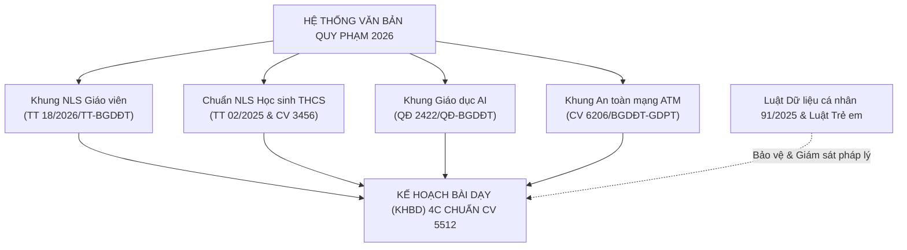
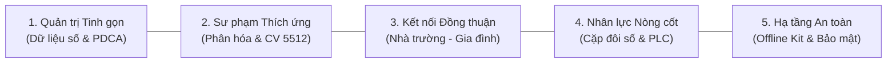
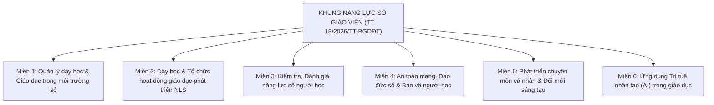
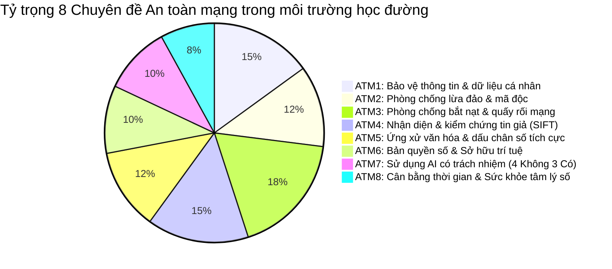
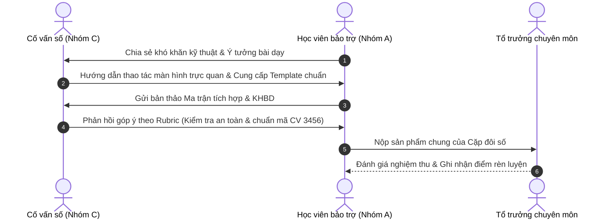
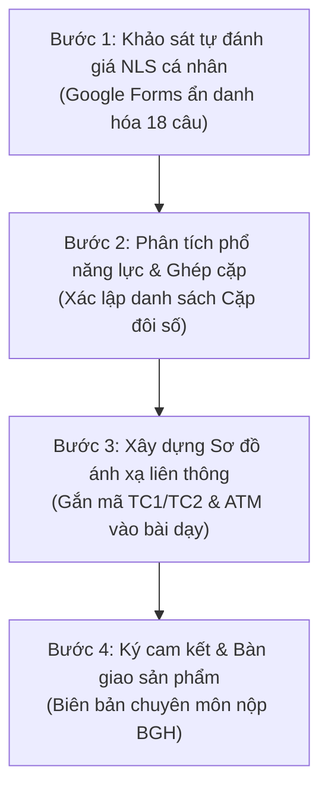

# BỘ GIÁO DỤC VÀ ĐÀO TẠO — HỌC VIỆN QUẢN LÝ GIÁO DỤC
### SỞ GIÁO DỤC VÀ ĐÀO TẠO TỈNH NGHỆ AN
***

# TÀI LIỆU BỒI DƯỠNG NĂNG LỰC SỐ VÀ SƯ PHẠM SỐ THÍCH ỨNG CẤP TRUNG HỌC CƠ SỞ
### *(Tài liệu lưu hành nội bộ phục vụ bồi dưỡng Cán bộ quản lý và Giáo viên THCS tỉnh Nghệ An – Năm học 2026–2027)*

---

## CHUYÊN ĐỀ 1: CƠ SỞ PHÁP LÝ, KHUNG NĂNG LỰC SỐ THCS VÀ THIẾT KẾ MA TRẬN ÁNH XẠ SƯ PHẠM SỐ THÍCH ỨNG

- **Mã chuyên đề:** CĐ-01/THCS-NA
- **Thời lượng:** 04 tiết (180 phút) — Buổi sáng Ngày 1
- **Đối tượng:** Cán bộ quản lý (Hiệu trưởng, Phó Hiệu trưởng), Tổ trưởng chuyên môn và Giáo viên cốt cán cấp THCS
- **Đơn vị phát triển nội dung:** Học viện Quản lý Giáo dục (NAEM) phối hợp Sở GD&ĐT Nghệ An

---

### MỤC LỤC CHUYÊN ĐỀ
1. **MỤC TIÊU BỒI DƯỠNG VÀ CHUẨN ĐẦU RA CHUYÊN ĐỀ**
2. **PHẦN I: HỆ THỐNG VĂN BẢN QUY PHẠM PHÁP LUẬT VÀ BỐI CẢNH CHUYỂN ĐỔI SỐ GIÁO DỤC NGHỆ AN**
   - 1.1. Hệ thống 06 văn bản quy phạm pháp luật cốt lõi (Khung pháp lý 2026)
   - 1.2. Phân tích bối cảnh: Nghịch lý 10 năm thiết bị trình chiếu và thách thức công dân số THCS
   - 1.3. Mô hình 5 Trụ cột Chuyển đổi số toàn diện cấp trường THCS
3. **PHẦN II: CẤU TRÚC LIÊN THÔNG ĐỒNG BỘ 4 TẦNG NĂNG LỰC SỐ**
   - 2.1. Khung 6 Miền Năng lực số Giáo viên theo Thông tư số 18/2026/TT-BGDĐT
   - 2.2. Khung Năng lực số Người học THCS (Bậc 3 - TC1 và Bậc 4 - TC2 theo Công văn 3456)
   - 2.3. Khung 4 Mạch nội dung giáo dục Trí tuệ nhân tạo (Quyết định 2422)
   - 2.4. Khung 8 Chuyên đề Giáo dục An toàn mạng toàn diện (Công văn 6206)
   - 2.5. Ma trận ánh xạ liên thông 4 tầng vào môn học và hoạt động giáo dục
4. **PHẦN III: PHƯƠNG PHÁP SƯ PHẠM SỐ THÍCH ỨNG VÀ CHIẾN LƯỢC ĐỒNG ĐẲNG 'CẶP ĐÔI SỐ'**
   - 3.1. Tiêu chí phân luồng học viên đầu vào (Nhóm A - Nhóm B - Nhóm C)
   - 3.2. Cơ chế vận hành Mạng lưới "Cặp đôi số" (Digital Mentoring 1-kèm-1)
   - 3.3. Giải pháp khắc phục đứt gãy hạ tầng: Bộ công cụ Offline Kit Nghệ An
5. **PHẦN IV: QUY TRÌNH THỰC HÀNH 4 BƯỚC HOÀN THÀNH SẢN PHẨM NHIỆM VỤ 01**
   - 4.1. Bước 1: Khảo sát tự đánh giá năng lực số cá nhân ẩn danh (Google Forms)
   - 4.2. Bước 2: Phân tích phổ năng lực và bắt cặp hỗ trợ chuyên môn
   - 4.3. Bước 3: Thiết lập Sơ đồ ánh xạ liên thông địa chỉ tích hợp vào Kế hoạch dạy học
   - 4.4. Bước 4: Soạn thảo Biên bản thỏa thuận hợp tác Cặp đôi số cấp Tổ chuyên môn
6. **PHẦN V: HỆ THỐNG PROMPT 4 THẺ CHUẨN HÓA VÀ CÔNG CỤ SỐ BỔ TRỢ**
   - 5.1. Cấu trúc chuẩn hóa Prompt 4 thẻ sư phạm
   - 5.2. Mẫu Prompt 01: Phiếu tự phản tư phát triển năng lực số giáo viên
   - 5.3. Mẫu Prompt 02: Thiết kế ma trận tích hợp liên thông bộ môn
7. **PHẦN VI: BẢNG TIÊU CHÍ ĐÁNH GIÁ NGHIỆM THU SẢN PHẨM (RUBRIC ĐẠT CHUẨN)**
8. **PHẦN VII: BẢNG KIỂM BÀN GIAO HỒ SƠ VÀ KẾ HOẠCH HÀNH ĐỘNG CÁ NHÂN**

---

### MỤC TIÊU BỒI DƯỠNG VÀ CHUẨN ĐẦU RA CHUYÊN ĐỀ

Sau khi hoàn thành Chuyên đề 1, học viên đạt được các chuẩn đầu ra cụ thể sau:

#### 1. Về kiến thức
- Hệ thống hóa được tính pháp lý và mối quan hệ hữu cơ giữa 06 văn bản chỉ đạo của Bộ GD&ĐT và Quốc hội về chuyển đổi số, an toàn mạng và trí tuệ nhân tạo áp dụng từ năm 2026.
- Giải thích được cấu trúc liên thông 4 tầng: Khung 6 miền NLS giáo viên (TT 18/2026) ↔ Khung 6 miền NLS học sinh THCS (TC1/TC2 theo CV 3456) ↔ 4 mạch nội dung giáo dục AI (QĐ 2422) ↔ 8 chuyên đề An toàn mạng (CV 6206).
- Nắm vững nguyên tắc cốt lõi: *"Tích hợp NLS là lồng ghép vào hoạt động môn học sẵn có theo CTGDPT 2018, tuyệt đối không làm phát sinh tiết học mới hay khung năng lực song song"*.

#### 2. Về kỹ năng
- Khởi tạo và vận hành được công cụ khảo sát ẩn danh trực tuyến (Google Forms / Google Sheets) nhằm đo lường năng lực số cá nhân và học sinh theo đúng quy định bảo mật của Luật Dữ liệu 91/2025/QH15.
- Thiết kế được 01 Sơ đồ ma trận ánh xạ tích hợp địa chỉ NLS - AI - ATM vào chương trình môn học mình phụ trách (tối thiểu 01 chủ đề/bài học).
- Thiết lập và cam kết trách nhiệm trong mạng lưới "Cặp đôi số" (Digital Mentoring) tại tổ bộ môn.

#### 3. Về phẩm chất và trách nhiệm sư phạm
- Nhận thức sâu sắc trách nhiệm bảo vệ học sinh THCS (lứa tuổi 11–14, trẻ em dưới 16 tuổi) trước các rủi ro không gian mạng (lộ lọt dữ liệu, bắt nạt mạng, tin giả, lệ thuộc thiết bị số).
- Thể hiện tinh thần sẵn sàng chia sẻ, đồng hành sư phạm số không bỏ lại đồng nghiệp phía sau, đặc biệt là các điểm trường vùng khó khăn của tỉnh Nghệ An.

---

### PHẦN I: HỆ THỐNG VĂN BẢN QUY PHẠM PHÁP LUẬT VÀ BỐI CẢNH CHUYỂN ĐỔI SỐ GIÁO DỤC NGHỆ AN

#### 1.1. Hệ thống 06 văn bản quy phạm pháp luật cốt lõi

Chương trình bồi dưỡng được xây dựng dựa trên sự tích hợp đồng bộ các văn bản quy phạm pháp luật mới nhất có hiệu lực thi hành trong năm 2026:

| TT | Ký hiệu văn bản | Ngày ban hành & Hiệu lực | Cơ quan ban hành | Tên gọi & Nội dung chỉ đạo trọng tâm |
| :---: | :--- | :--- | :--- | :--- |
| **01** | **Thông tư số 18/2026/TT-BGDĐT** | Ký ngày 27/03/2026;<br>Hiệu lực từ 12/05/2026 | Bộ Giáo dục và Đào tạo | Ban hành **Khung năng lực số đối với nhà giáo và cán bộ quản lý** cơ sở giáo dục mầm non, phổ thông và GDTX. Xác lập 06 miền năng lực, 20 năng lực thành phần với 03 cấp độ chuẩn: Cơ bản – Thành thạo – Nâng cao. |
| **02** | **Thông tư 02/2025/TT-BGDĐT** & **Công văn 3456/BGDĐT-GDPT** | Ký ngày 24/01/2025 &<br>hướng dẫn 27/06/2025 | Bộ Giáo dục và Đào tạo | Quy định **Khung năng lực số cho người học**. Quy định học sinh THCS áp dụng: **Bậc 3 (Trung cấp 1 - TC1)** cho lớp 6–7 và **Bậc 4 (Trung cấp 2 - TC2)** cho lớp 8–9. |
| **03** | **Quyết định số 2422/QĐ-BGDĐT** | Ký ngày 18/08/2026 | Bộ Giáo dục và Đào tạo | Ban hành **Khung nội dung giáo dục Trí tuệ nhân tạo (AI)** cho học sinh phổ thông. Gồm 04 mạch kiến thức: Tư duy con người là trung tâm (NLa), Đạo đức AI (NLb), Kỹ thuật & Ứng dụng AI (NLc), Thiết kế hệ thống AI (NLd). |
| **04** | **Công văn số 6206/BGDĐT-GDPT** | Ký ngày 04/09/2026 | Bộ Giáo dục và Đào tạo | Hướng dẫn triển khai thực hiện **Giáo dục An toàn mạng (ATM) toàn diện** trong các cơ sở giáo dục phổ thông năm học 2026–2027 theo 08 nhóm nội dung trọng tâm (ATM1–ATM8). |
| **05** | **Công văn số 5512/BGDĐT-GDTrH** & **QĐ 4725/QĐ-BGDĐT** | Văn bản hiện hành | Bộ Giáo dục và Đào tạo | Quy định cấu trúc hồ sơ chuyên môn và **Kế hoạch bài dạy (KHBD)**; Bộ chỉ số đánh giá mức độ chuyển đổi số cơ sở giáo dục phổ thông. Tích hợp chỉ báo số vào 04 hoạt động chuẩn của CV 5512. |
| **06** | **Luật Bảo vệ dữ liệu cá nhân số 91/2025/QH15** & **Luật An ninh mạng** | Hiệu lực từ 01/01/2026 &<br>01/07/2026 | Quốc hội nước CHXHCN Việt Nam | Quy định nghiêm ngặt về quyền riêng tư, an toàn dữ liệu; nghiêm cấm thu thập dữ liệu định danh trẻ em dưới 16 tuổi khi chưa có sự đồng ý của cha mẹ; quy chế bảo mật thông tin học đường. |



#### 1.2. Phân tích bối cảnh: Nghịch lý 10 năm thiết bị trình chiếu và thách thức công dân số THCS

Trong giai đoạn 2014–2024, công tác ứng dụng CNTT tại các trường THCS tỉnh Nghệ An đã đạt được những bước tiến vượt bậc về cơ sở vật chất (máy chiếu, màn hình tương tác thông minh, đường truyền cáp quang). Tuy nhiên, trên bình diện phương pháp sư phạm, ngành giáo dục đang chứng kiến một **nghịch lý sư phạm số kéo dài 10 năm**:

1. **Từ "Đọc - Chép truyền thống" sang "Nhìn - Chép điện tử":** Thiết bị số hiện đại thường chỉ được sử dụng như một phương tiện thay thế bảng đen (chiếu bài giảng slide PowerPoint dày đặc chữ), học sinh vẫn đóng vai trò thụ động tiếp nhận, chưa trực tiếp thao tác dữ liệu hay rèn luyện năng lực số.
2. **Khủng hoảng an toàn của học sinh lứa tuổi 11–14 trên môi trường số:**
   - Học sinh THCS bước vào giai đoạn biến đổi tâm sinh lý mạnh mẽ, tò mò khám phá nhưng thiếu kỹ năng tự vệ số.
   - Các nguy cơ nghiêm trọng gia tăng: lộ lọt dữ liệu cá nhân, trở thành nạn nhân hoặc thủ phạm bắt nạt mạng (Cyberbullying), tin theo tin giả (Fake News) và hội chứng lệ thuộc thiết bị số, suy giảm chú ý.
3. **Thách thức của làn sóng Trí tuệ nhân tạo (GenAI):** Học sinh dễ dàng dùng AI để làm bài hộ dẫn đến gian lận học thuật, mất đi năng lực tư duy phản biện và tiếp nhận các thông tin "ảo giác" (Hallucination) do AI tự tạo ra.

Do đó, mục tiêu của chương trình bồi dưỡng 2026 là **chuyển dịch căn bản từ "Sử dụng công nghệ để trình diễn bài giảng" sang "Ứng dụng sư phạm số để phát triển năng lực tự chủ, thích ứng và an toàn cho người học"**.

#### 1.3. Mô hình 5 Trụ cột Chuyển đổi số toàn diện cấp trường THCS

Chuyển đổi số không phải là việc mua sắm thiết bị đơn thuần, mà là một hệ thống chuyển đổi đồng bộ 05 trụ cột:



- **Trụ cột 1: Quản trị tinh gọn** — Ban Giám hiệu ra quyết định dựa trên dữ liệu (Data-driven Decision Making), số hóa hồ sơ sổ sách, cắt giảm thủ tục hành chính giấy tờ rườm rà.
- **Trụ cột 2: Sư phạm thích ứng** — Đổi mới phương pháp dạy học theo mô hình phân hóa năng lực, lấy học sinh làm trung tâm, tích hợp các công cụ số vào 04 hoạt động học chuẩn CV 5512.
- **Trụ cột 3: Kết nối đồng thuận** — Thiết lập kênh trao đổi thông tin số minh bạch, an toàn giữa nhà trường, giáo viên chủ nhiệm và cha mẹ học sinh nhằm giám sát bảo vệ trẻ trên mạng.
- **Trụ cột 4: Nhân lực nòng cốt** — Xây dựng cộng đồng học tập chuyên môn (PLC), nuôi dưỡng các hạt nhân nòng cốt và triển khai mạng lưới cố vấn "Cặp đôi số" (1-kèm-1).
- **Trụ cột 5: Hạ tầng an toàn và thích ứng** — Đảm bảo an toàn thông tin mạng, bảo vệ dữ liệu cá nhân học sinh và sẵn sàng các kịch bản ngoại tuyến (Offline Kit) ứng phó đứt gãy kết nối tại địa bàn khó khăn.

---

### PHẦN II: CẤU TRÚC LIÊN THÔNG ĐỒNG BỘ 4 TẦNG NĂNG LỰC SỐ

Nhằm tránh tình trạng "quá tải chương trình" hoặc "tạo thêm gánh nặng hồ sơ sổ sách", giáo viên cần nắm vững cơ chế liên thông 4 tầng sau đây:

#### 2.1. Khung 6 Miền Năng lực số Giáo viên theo Thông tư số 18/2026/TT-BGDĐT

Thông tư 18 quy định 06 miền năng lực số cốt lõi của nhà giáo:



Mỗi miền năng lực được đo lường qua 03 mức độ phát triển:
- **Mức 1 (Cơ bản - Nhóm A):** Nhận biết, sử dụng thành thạo các phần mềm cơ bản theo chỉ đạo; tuân thủ quy tắc bảo mật dữ liệu.
- **Mức 2 (Thành thạo - Nhóm B):** Độc lập thiết kế bài dạy tích hợp NLS; chủ động sáng tạo học liệu đa phương tiện; xử lý tốt các tình huống an toàn mạng học đường.
- **Mức 3 (Nâng cao - Nhóm C):** Đóng vai trò cố vấn chuyên môn (Mentor); huấn luyện trợ lý ảo cá nhân hóa; điều hành sinh hoạt chuyên môn số và chia sẻ tài nguyên cho cụm trường.

#### 2.2. Khung Năng lực số Học sinh THCS (Bậc 3: TC1 và Bậc 4: TC2 theo Công văn 3456)

Người học cấp THCS được phân định thành 02 chuẩn năng lực bậc trung cấp:
- **Chuẩn TC1 (Lớp 6 – Lớp 7):** Vận hành thiết bị công nghệ quen thuộc; tìm kiếm thông tin có từ khóa; tạo lập sản phẩm số đơn giản (văn bản, bài trình chiếu, sơ đồ tư duy); nhận biết các rủi ro cơ bản trên mạng và biết nhờ người lớn trợ giúp.
- **Chuẩn TC2 (Lớp 8 – Lớp 9):** Đánh giá độ tin cậy của nguồn tin; áp dụng kỹ thuật tìm kiếm nâng cao; sử dụng bảng tính để phân tích số liệu; tạo lập nội dung đa phương tiện có bản quyền; chủ động bảo vệ danh tính số và tự giác áp dụng quy tắc ứng xử văn hóa trên mạng.

#### 2.3. Khung 4 Mạch nội dung giáo dục Trí tuệ nhân tạo (Quyết định 2422)

Chương trình giáo dục AI cho học sinh THCS không đi sâu vào lập trình thuật toán phức tạp mà tập trung vào nhận thức và năng lực vận dụng:
- **NLa (Tư duy lấy con người làm trung tâm):** Nhận diện vai trò của AI như một công cụ hỗ trợ con người; không thần thánh hóa AI; con người luôn là chủ thể ra quyết định cuối cùng.
- **NLb (Đạo đức AI & Trách nhiệm):** Nhận diện tính thiên kiến (bias), bản quyền tác giả số, không dùng AI để gian lận kiểm tra đánh giá hoặc tạo nội dung bôi nhọ người khác.
- **NLc (Kỹ thuật và Ứng dụng AI):** Sử dụng các công cụ AI tạo sinh phổ biến (Gemini, ChatGPT, Canva Magic) để tìm kiếm ý tưởng, tóm tắt tư liệu và hỗ trợ giải quyết vấn đề học tập.
- **NLd (Thiết kế hệ thống AI mức cơ bản):** Hiểu nguyên lý máy học thông qua dữ liệu đầu vào (Prompt) để tạo đầu ra (Output); nhận diện lỗi sai và biết cách hiệu chỉnh câu lệnh (Prompt Engineering).

#### 2.4. Khung 8 Chuyên đề Giáo dục An toàn mạng toàn diện (Công văn 6206)

Tám nhóm nội dung an toàn mạng (ATM1–ATM8) được tích hợp xuyên suốt:



#### 2.5. Ma trận ánh xạ liên thông 4 tầng vào môn học và hoạt động giáo dục

Nguyên tắc vàng: **Môn Tin học (Chủ đề D) chịu trách nhiệm dạy nguyên lý nền tảng. Các môn học khác (Toán, KHTN, Ngữ văn, Lịch sử - Địa lí, GDCD, HĐTN-HN) là môi trường thực hành vận dụng.**

*Bảng minh họa tích hợp liên thông:*

| Môn học & Khối lớp | Tên bài dạy theo CTGDPT 2018 | Mã NLS Học sinh (CV 3456) | Mạch Giáo dục AI (QĐ 2422) | Chuyên đề An toàn mạng (CV 6206) | Hoạt động sư phạm số tương ứng |
| :--- | :--- | :---: | :---: | :---: | :--- |
| **KHTN 6** | Tế bào - Đơn vị cơ sở của sự sống | **TC1.2** (Khai thác thông tin số) | **NLc** (Ứng dụng AI tạo sinh) | **ATM4** (Kiểm chứng nguồn tin) | Học sinh dùng kính hiển vi điện tử / mô hình 3D quan sát tế bào; đối chiếu hình ảnh do AI mô tả với mẫu tiêu bản thực tế. |
| **Ngữ văn 8** | Nghị luận xã hội về một vấn đề đời sống | **TC2.4** (Sáng tạo nội dung số) | **NLa, NLb** (Đạo đức & Tư duy người) | **ATM5, ATM6** (Ứng xử văn hóa & Bản quyền) | Học sinh viết bài tranh biện về hiện tượng "Bắt nạt mạng qua nhóm kín"; dẫn nguồn minh bạch, trích dẫn quy định của Luật Trẻ em 2016. |
| **Lịch sử & Địa lí 7** | Khí hậu và cảnh quan Châu Phi | **TC1.3** (Hợp tác môi trường số) | **NLc** (Trực quan hóa dữ liệu) | **ATM1** (Bảo vệ thông tin cá nhân) | Làm việc nhóm trên Google Docs chia sẻ tư liệu; tuyệt đối không để lộ thông tin liên lạc cá nhân khi chia sẻ tài liệu công khai. |
| **Toán 9** | Thống kê và Biểu diễn dữ liệu | **TC2.3** (Xử lý dữ liệu bảng tính) | **NLd** (Hiểu nguyên lý dữ liệu) | **ATM8** (Khảo sát thời gian dùng màn hình) | Lập bảng tính Google Sheets điều tra thời lượng sử dụng Internet của học sinh trong lớp; vẽ biểu đồ phân tích cảnh báo nguy cơ nghiện game. |

---

### PHẦN III: PHƯƠNG PHÁP SƯ PHẠM SỐ THÍCH ỨNG VÀ CHIẾN LƯỢC ĐỒNG ĐẲNG 'CẶP ĐÔI SỐ'

#### 3.1. Tiêu chí phân luồng học viên đầu vào (Nhóm A - Nhóm B - Nhóm C)

Để bồi dưỡng hiệu quả, tránh cào bằng hoặc gây quá tải cho giáo viên lớn tuổi, giáo viên vùng sâu vùng xa, khóa tập huấn tiến hành phân luồng đầu vào dựa trên kết quả Phiếu tự khảo sát 18 câu:

| Phân nhóm học viên | Đặc điểm năng lực đầu vào | Nhiệm vụ chuyên môn trong khóa tập huấn |
| :---: | :--- | :--- |
| **Nhóm A<br>(Cơ bản - Cần hỗ trợ)** | - Sử dụng máy tính ở mức cơ bản, ngại thao tác phần mềm mới.<br>- Quen thuộc với cách dạy truyền thống, trình chiếu slide bài giảng đơn giản.<br>- Chưa từng thao tác với công cụ AI tạo sinh hay lưu trữ đám mây. | - Điền phiếu khảo sát, nhận diện khoảng cách năng lực của bản thân.<br>- Nắm vững khung văn bản pháp quy và bộ quy tắc an toàn dữ liệu.<br>- Bắt cặp 1-kèm-1 với giáo viên Nhóm C để thực hành từng bước.<br>- Hoàn thiện ma trận tích hợp dựa trên các mẫu có sẵn (Template). |
| **Nhóm B<br>(Thành thạo - Độc lập)** | - Sử dụng máy tính thành thạo, thường xuyên ứng dụng CNTT trong dạy học.<br>- Tự thiết kế được phiếu học tập, trò chơi trắc nghiệm (Kahoot, Quizizz).<br>- Có hiểu biết cơ bản về AI nhưng chưa hệ thống hóa theo chuẩn pháp lý. | - Độc lập thiết kế Ma trận tích hợp liên thông cho ít nhất 03 bài học.<br>- Xây dựng Kế hoạch bài dạy (KHBD) 4C chuẩn CV 5512 lồng ghép bài bản NLS - AI - ATM.<br>- Thiết kế bộ học liệu số đa phương tiện và phương án dự phòng ngoại tuyến. |
| **Nhóm C<br>(Nâng cao - Nòng cốt)** | - Khả năng công nghệ xuất sắc, là giáo viên dạy giỏi / cốt cán bộ môn.<br>- Sử dụng linh hoạt nhiều nền tảng số, có tư duy phản biện công nghệ sâu sắc.<br>- Có khả năng hướng dẫn, hỗ trợ đồng nghiệp trong tổ chuyên môn. | - Đảm nhận vai trò **Cố vấn đồng đẳng (Digital Mentor)** trong "Cặp đôi số".<br>- Hỗ trợ giáo viên Nhóm A vượt qua các rào cản kỹ thuật.<br>- Cấu hình Trợ lý ảo (Gemini Gems) chuyên biệt cho tổ chuyên môn.<br>- Thẩm định sản phẩm chuyên môn trước khi nghiệm thu. |

#### 3.2. Cơ chế vận hành Mạng lưới "Cặp đôi số" (Digital Mentoring 1-kèm-1)

"Cặp đôi số" là giải pháp sư phạm cốt lõi nhằm giải quyết bài toán chênh lệch trình độ công nghệ trong cùng một hội đồng sư phạm:



- **Nguyên tắc ghép cặp:** Giáo viên Nhóm C ghép cặp cùng giáo viên Nhóm A trong cùng tổ chuyên môn hoặc bộ môn liên môn (Khoa học tự nhiên, Khoa học xã hội).
- **Cam kết trách nhiệm:** Giáo viên Nhóm C không làm thay, làm hộ; chỉ đóng vai trò hướng dẫn thao tác, tháo gỡ điểm nghẽn và động viên tinh thần. Thành công của người được bảo trợ là tiêu chí đánh giá mức độ hoàn thành nhiệm vụ của người cố vấn.

#### 3.3. Giải pháp khắc phục đứt gãy hạ tầng: Bộ công cụ Offline Kit Nghệ An

Nghệ An có địa bàn rộng lớn với nhiều điểm trường miền núi (Kỳ Sơn, Tương Dương, Quế Phong, Quỳ Châu, Con Cuông) thường xuyên đối mặt với nguy cơ mất điện, đứt cáp quang hoặc phòng học không có màn hình tương tác. Bộ công cụ thích ứng **Nghệ An Offline Kit** là điều kiện bắt buộc trong mọi kế hoạch bài dạy:

```
┌────────────────────────────────────────────────────────────────────────┐
│                   HỆ THỐNG NGHỆ AN OFFLINE KIT                         │
├────────────────────────────────┬───────────────────────────────────────┤
│    KỊCH BẢN TRỰC TUYẾN (ONLINE)│     KỊCH BẢN NGOẠI TUYẾN (OFFLINE)    │
├────────────────────────────────┼───────────────────────────────────────┤
│ 1. Khảo sát Google Forms       │ 1. Bộ Phiếu tự đánh giá in sẵn A4 phát│
│    tự động chấm điểm           │    tại bàn, tính điểm thủ công theo sơ│
│                                │    đồ mạng nhện.                      │
├────────────────────────────────┼───────────────────────────────────────┤
│ 2. Tra cứu NotebookLM / Gemini │ 2. Sổ tay Tóm lược quy phạm in màu    │
│    qua kết nối Internet        │    đóng tập (Core Pocket Guide) để    │
│                                │    học viên tra cứu tại chỗ.          │
├────────────────────────────────┼───────────────────────────────────────┤
│ 3. Vẽ sơ đồ ma trận trên Canva │ 3. Giấy Ao, Giấy nhớ (Post-it) nhiều  │
│    hoặc phần mềm mindmap       │    màu, bút dạ; vẽ sơ đồ xương cá và  │
│                                │    dán trực tiếp lên bảng lớp.        │
├────────────────────────────────┼───────────────────────────────────────┤
│ 4. Tổ chức Cặp đôi số qua Zoom │ 4. Ghép bàn chữ U, bố trí Cặp đôi số  │
│    / Google Meet / Zalo nhóm   │    ngồi cạnh nhau "Cầm tay chỉ việc"  │
│                                │    trên một thiết bị dùng chung.      │
└────────────────────────────────┴───────────────────────────────────────┘
```

---

### PHẦN IV: QUY TRÌNH THỰC HÀNH 4 BƯỚC HOÀN THÀNH SẢN PHẨM NHIỆM VỤ 01

Học viên làm việc theo tiến trình 4 bước chuẩn hóa để tạo lập sản phẩm bàn giao cuối buổi:



#### 4.1. Bước 1: Khảo sát tự đánh giá năng lực số cá nhân ẩn danh (Google Forms)
- **Mục đích:** Xác định chính xác vị trí năng lực hiện tại của bản thân theo 06 miền của Thông tư 18/2026/TT-BGDĐT.
- **Yêu cầu bảo mật:** 100% tuân thủ Luật Bảo vệ dữ liệu cá nhân 91/2025/QH15. Biểu mẫu khảo sát tuyệt đối **KHÔNG thu thập**: Họ tên thật, số căn cước công dân, số điện thoại, email cá nhân. Học viên chỉ nhập Mã số định danh ẩn danh (ví dụ: `GV-THCS-01`, `GV-THCS-02`).
- **Thao tác thực hiện:**
  1. Truy cập đường link hoặc quét mã QR do Ban tổ chức cung cấp.
  2. Đọc kỹ 18 câu hỏi trắc nghiệm tương ứng 06 miền năng lực (thang điểm Likert từ 1 đến 5).
  3. Bấm "Gửi" và ghi lại tổng điểm cùng kết luận xếp nhóm của hệ thống (A, B hoặc C).

*Mẫu biểu 4.1: Cấu trúc 18 tiêu chí tự đánh giá (Trích đoạn minh họa):*

```
[MIỀN 1: TỔ CHỨC DẠY HỌC TRONG MÔI TRƯỜNG SỐ]
- Câu 1.1: Thầy/Cô sử dụng thành thạo phần mềm soạn thảo và trình chiếu bài giảng theo quy định. (Mức 1 - 5)
- Câu 1.2: Thầy/Cô biết cách tổ chức lớp học tương tác qua mạng (Google Classroom, MS Teams, LMS). (Mức 1 - 5)
- Câu 1.3: Thầy/Cô có khả năng số hóa học liệu bài giảng và chia sẻ an toàn cho học sinh. (Mức 1 - 5)

[MIỀN 4: AN TOÀN MẠNG VÀ BẢO VỆ NGƯỜI HỌC]
- Câu 4.1: Thầy/Cô nắm vững Luật Bảo vệ dữ liệu cá nhân 91/2025/QH15 về bảo mật thông tin trẻ em. (Mức 1 - 5)
- Câu 4.2: Thầy/Cô thường xuyên hướng dẫn học sinh kỹ năng kiểm chứng tin giả theo quy tắc 4 bước SIFT. (Mức 1 - 5)
- Câu 4.3: Thầy/Cô biết cách xử lý quy trình 4 bước khi xảy ra sự cố bắt nạt hoặc lộ thông tin học sinh trên mạng. (Mức 1 - 5)
```

#### 4.2. Bước 2: Phân tích phổ năng lực và thiết lập cặp đôi số
- **Mục đích:** Thành lập danh sách phân luồng chính thức của đơn vị và kết nối hỗ trợ chuyên môn.
- **Thao tác thực hiện:**
  1. Báo cáo viên xuất dữ liệu bảng tính Google Sheets của lớp học.
  2. Bảng tính tự động chạy hàm phân loại dựa trên điểm tổng:
     - Dưới 45 điểm: **Nhóm A (Cơ bản)**.
     - Từ 45 đến 75 điểm: **Nhóm B (Thành thạo)**.
     - Trên 75 điểm: **Nhóm C (Nâng cao)**.
  3. Tổ trưởng chuyên môn điều phối ghép 01 giáo viên Nhóm C với 01 giáo viên Nhóm A. Điền thông tin vào *Biên bản phân công Cặp đôi số*.

#### 4.3. Bước 3: Thiết lập Sơ đồ ánh xạ liên thông địa chỉ tích hợp vào Kế hoạch dạy học
- **Mục đích:** Chỉ ra chính xác bài nào, tiết nào trong chương trình bộ môn sẽ tích hợp chỉ báo NLS nào của học sinh.
- **Thao tác thực hiện:**
  1. Mở phân phối chương trình môn học hiện hành theo CTGDPT 2018.
  2. Chọn 01 bài học cụ thể trong học kỳ tới.
  3. Tra cứu Bảng mã chỉ báo TC1/TC2 (theo Công văn 3456) và Bảng nhóm An toàn mạng (CV 6206).
  4. Lập bảng ánh xạ theo mẫu chuẩn sau:

*Mẫu biểu 4.2: Khung Ma trận ánh xạ địa chỉ tích hợp chuẩn hóa:*

```
TRƯỜNG THCS: ...........................................  TỔ CHUYÊN MÔN: .......................................
MÔN HỌC: ..............................................  LỚP: ............. NĂM HỌC: 2026 - 2027

                            MA TRẬN ÁNH XẠ LIÊN THÔNG ĐỊA CHỈ TÍCH HỢP
                  NĂNG LỰC SỐ, GIÁO DỤC AN TOÀN MẠNG VÀ TRÍ TUỆ NHÂN TẠO

1. Tên bài học / Chủ đề: ................................................................................
2. Thời lượng thực hiện: ........ tiết (Tuần thực hiện: .........)
3. Mục tiêu cần đạt của bài học (Theo CTGDPT 2018): .....................................................
........................................................................................................
4. Địa chỉ tích hợp liên thông:
┌───────────────────────────────┬───────────────────────────┬──────────────────────────────────────────┐
│ Cột 1: Thành phần tích hợp    │ Cột 2: Mã chỉ báo quy định│ Cột 3: Hành vi học sinh thực hiện cụ thể │
├───────────────────────────────┼───────────────────────────┼──────────────────────────────────────────┤
│ a) Năng lực số học sinh       │ TC1.x / TC2.x (CV 3456)   │ ........................................ │
├───────────────────────────────┼───────────────────────────┼──────────────────────────────────────────┤
│ b) Giáo dục An toàn mạng      │ ATM1 đến ATM8 (CV 6206)   │ ........................................ │
├───────────────────────────────┼───────────────────────────┼──────────────────────────────────────────┤
│ c) Giáo dục Trí tuệ nhân tạo  │ NLa / NLb / NLc / NLd     │ ........................................ │
└───────────────────────────────┴───────────────────────────┴──────────────────────────────────────────┘
5. Phương án dự phòng ngoại tuyến (Offline Kit): ........................................................
........................................................................................................
```

#### 4.4. Bước 4: Soạn thảo Biên bản thỏa thuận hợp tác Cặp đôi số cấp Tổ chuyên môn
- Đại diện Cặp đôi số ký cam kết kế hoạch đồng hành trong suốt 6 buổi tập huấn và giai đoạn 4 tuần chuyển hóa tại trường.
- Nộp biên bản và sơ đồ ma trận lên hệ thống quản lý học tập (LMS) hoặc nộp bản in cho Ban tổ chức.

---

### PHẦN V: HỆ THỐNG PROMPT 4 THẺ CHUẨN HÓA VÀ CÔNG CỤ SỐ BỔ TRỢ

Nhằm hỗ trợ giáo viên khai thác AI tạo sinh (Gemini, ChatGPT) hiệu quả và tránh hiện tượng "câu trả lời chung chung vô căn cứ", chương trình chuẩn hóa kỹ thuật giao tiếp với AI bằng **Mô hình Prompt 4 thẻ**:

```
┌────────────────────────────────────────────────────────────────────────┐
│                   CẤU TRÚC PROMPT 4 THẺ SƯ PHẠM                       │
├────────────────────────────────────────────────────────────────────────┤
│  thẻ 1: [NGỮ CẢNH] (Context)                                          │
│ Xác lập vai trò chuyên môn, đối tượng người học, khung pháp lý căn cứ. │
├────────────────────────────────────────────────────────────────────────┤
│ thẻ 2: [DỮ LIỆU / ĐIỀU KIỆN] (Data & Constraints)                      │
│ Cung cấp dữ liệu đầu vào: tên bài học, YCCĐ, điều kiện hạ tầng, cấm.   │
├────────────────────────────────────────────────────────────────────────┤
│ thẻ 3: [HƯỚNG DẪN THỰC HIỆN] (Instructions)                           │
│ Yêu cầu từng bước suy luận, phương pháp sư phạm cần áp dụng.           │
├────────────────────────────────────────────────────────────────────────┤
│ thẻ 4: [KẾT QUẢ MONG MUỐN] (Expected Output)                           │
│ Định dạng đầu ra: bảng biểu, gạch đầu dòng, ngôn ngữ sư phạm chuẩn mực.│
└────────────────────────────────────────────────────────────────────────┘
```

#### 5.1. Mẫu Prompt 01: Phiếu tự phản tư phát triển năng lực số giáo viên (TT 18/2026)

*Sử dụng prompt này trên Google Gemini để nhận diện lộ trình phát triển chuyên môn cá nhân:*

```markdown
[Ngữ cảnh]
Tôi là giáo viên cấp Trung học cơ sở tại tỉnh Nghệ An. Tôi đang tham gia chương trình bồi dưỡng phát triển Năng lực số và Sư phạm số thích ứng năm 2026. Tôi cần một công cụ tự phản tư chuyên sâu để xác định chính xác vị trí năng lực hiện tại của mình và xây dựng kế hoạch bồi dưỡng cá nhân phù hợp với điều kiện thực tế của nhà trường.

[Dữ liệu/điều kiện]
- Căn cứ pháp lý: Thông tư số 18/2026/TT-BGDĐT ban hành Khung năng lực số đối với giáo viên (gồm 6 miền năng lực và 20 năng lực thành phần, 3 mức độ: Cơ bản, Thành thạo, Nâng cao).
- Căn cứ liên thông: Công văn 3456/BGDĐT-GDPT (chuẩn NLS học sinh THCS bậc TC1/TC2), Công văn 6206/BGDĐT-GDPT (8 chuyên đề An toàn mạng ATM1-ATM8) và Quyết định 2422/QĐ-BGDĐT (giáo dục AI).
- Điều kiện hạ tầng: Trường tôi thuộc khu vực nông thôn/miền núi tỉnh Nghệ An, phòng học có màn hình tương tác nhưng kết nối mạng Internet đôi khi không ổn định; năng lực CNTT của học sinh trong lớp không đồng đều.
- Nguyên tắc: Không sao chép lý thuyết chung chung; tập trung vào hành vi sư phạm cụ thể và giải pháp thích ứng ngoại tuyến.

[Hướng dẫn]
1. Hãy thiết kế một Bảng tự phản tư gồm 6 miền năng lực theo Thông tư 18/2026/TT-BGDĐT. Với mỗi miền, đưa ra 03 tiêu chí hành vi rõ ràng (mức Cơ bản, Thành thạo, Nâng cao).
2. Xây dựng thang đo tự đánh giá (1: Chưa thực hiện; 2: Thực hiện khi có hướng dẫn; 3: Độc lập thực hiện; 4: Hướng dẫn được đồng nghiệp).
3. Đề xuất bảng phân tích khoảng cách năng lực (Gap Analysis): Chỉ ra 03 điểm nghẽn lớn nhất mà giáo viên THCS tại Nghệ An thường gặp phải và giải pháp sư phạm tương ứng.
4. Gợi ý cơ chế bắt cặp "Cặp đôi số" (1 kèm 1) trong tổ bộ môn: Tiêu chí lựa chọn người cố vấn (Mentor) và người được hỗ trợ (Mentee) để việc hợp tác thực chất, không hình thức.

[Kết quả mong muốn]
- Định dạng xuất bản: Bảng Markdown chuyên nghiệp, phân cấp rõ ràng, sẵn sàng in ra phát tại bàn tập huấn.
- Ngôn ngữ: Chuẩn mực sư phạm, khúc chiết, mang tính động viên và định hướng hành động.
- Có mục "Ghi chú dành cho Cán bộ quản lý" để Hiệu trưởng/Tổ trưởng sử dụng khi duyệt kế hoạch bồi dưỡng của giáo viên.
```

#### 5.2. Mẫu Prompt 02: Thiết kế ma trận tích hợp liên thông bộ môn

*Sử dụng prompt này để thiết lập nhanh ma trận ánh xạ cho một bài học cụ thể:*

```markdown
[Ngữ cảnh]
Tôi là giáo viên THCS tại tỉnh Nghệ An, phụ trách giảng dạy môn [ĐIỀN TÊN MÔN HỌC: KHTN / Toán / Ngữ văn / Lịch sử - Địa lí / GDCD / Công nghệ / HĐTN-HN]. Tôi cần thiết lập bảng Ma trận ánh xạ địa chỉ tích hợp Năng lực số (NLS), An toàn mạng (ATM) và Trí tuệ nhân tạo (AI) vào một bài học cụ thể thuộc Chương trình giáo dục phổ thông 2018.

[Dữ liệu/điều kiện]
- Thông tin bài dạy: Bài [TÊN BÀI DẠY], Lớp [KHỐI LỚP 6/7/8/9], Thời lượng thực hiện: [SỐ TIẾT].
- Yêu cầu cần đạt cốt lõi của bài học (trích nguyên văn CTGDPT 2018): [DÁN NỘI DUNG YCCĐ TẠI ĐÂY].
- Khung quy chiếu chuẩn hóa:
  + Năng lực số học sinh: Bậc 3 (TC1.1 - TC1.6 đối với lớp 6-7) hoặc Bậc 4 (TC2.1 - TC2.6 đối với lớp 8-9) theo Công văn 3456/BGDĐT-GDPT.
  + Giáo dục An toàn mạng: Chọn lọc từ ATM1 đến ATM8 theo Công văn 6206/BGDĐT-GDPT.
  + Giáo dục Trí tuệ nhân tạo: 4 mạch NLa, NLb, NLc, NLd theo Quyết định 2422/QĐ-BGDĐT.
- Ràng buộc sư phạm bắt buộc: Tích hợp tự nhiên vào hoạt động học sẵn có, tuyệt đối KHÔNG làm phát sinh tiết học mới; luôn có phương án dạy học dự phòng ngoại tuyến (Offline Kit) khi mất kết nối mạng.

[Hướng dẫn]
1. Phân tích Yêu cầu cần đạt của bài học để tìm ra "địa chỉ tích hợp tự nhiên nhất" (ở hoạt động Khởi động, Hình thành kiến thức, Luyện tập hay Vận dụng).
2. Xác định chính xác: 01 mã chỉ báo NLS (TC1 hoặc TC2), 01 nhóm An toàn mạng (ATM), 01 mạch AI phù hợp trực tiếp với nội dung bài.
3. Mô tả hành vi học sinh thực hiện: Học sinh làm gì với công cụ số để tạo ra sản phẩm học tập? (Tránh mô tả chung chung như 'học sinh tìm hiểu trên mạng').
4. Thiết kế phương án Offline Kit: Nếu phòng học không có Internet hoặc máy chiếu bị hỏng, giáo viên sẽ tổ chức hoạt động đó bằng học liệu in sẵn như thế nào để vẫn đạt được mục tiêu năng lực số?

[Kết quả mong muốn]
- Bảng Ma trận 5 cột định dạng Markdown chuẩn mực:
  + Cột 1: Tên hoạt động học theo chuẩn Công văn 5512 (Khởi động / Khám phá / Luyện tập / Vận dụng).
  + Cột 2: Mục tiêu kiến thức bộ môn.
  + Cột 3: Mã chỉ báo NLS học sinh & Hành vi minh chứng cụ thể.
  + Cột 4: Mã ATM / Mạch AI & Thông điệp an toàn số cần khắc sâu.
  + Cột 5: Phương án thích ứng ngoại tuyến (Nghệ An Offline Kit).
- Kèm theo 01 đoạn văn ngắn (dưới 100 từ) hướng dẫn giáo viên cách dẫn dắt sư phạm tự nhiên khi chuyển tiếp vào hoạt động số.
```

---

### PHẦN VI: BẢNG TIÊU CHÍ ĐÁNH GIÁ NGHIỆM THU SẢN PHẨM (RUBRIC ĐẠT CHUẨN)

Sản phẩm đầu ra của Chuyên đề 1 bao gồm: **(1) Phiếu tự khảo sát 6 miền NLS hoàn thành** và **(2) Sơ đồ ma trận ánh xạ địa chỉ tích hợp 01 bài dạy**. Tổ chuyên môn và Ban Giám hiệu sử dụng Rubric 4 mức độ sau đây để nghiệm thu:

| Tiêu chí đánh giá | Mức 1: Không đạt<br>(Dưới 50% yêu cầu) | Mức 2: Cần hoàn thiện<br>(50% - 74% yêu cầu) | Mức 3: Đạt chuẩn<br>(75% - 89% yêu cầu) | Mức 4: Xuất sắc<br>(90% - 100% yêu cầu) |
| :--- | :--- | :--- | :--- | :--- |
| **Tiêu chí 1:<br>Tính chuẩn xác pháp lý & Trích dẫn** *(Trọng số: 30%)* | Không trích dẫn căn cứ pháp lý hoặc trích dẫn sai mã văn bản; nhầm lẫn giữa TC1 (lớp 6-7) và TC2 (lớp 8-9). | Trích dẫn đúng tên văn bản nhưng chưa gắn đúng mã chỉ báo cụ thể với hành vi học sinh; còn tình trạng sao chép máy móc. | Trích dẫn chính xác mã TC1/TC2 (CV 3456), nhóm ATM (CV 6206) và mạch AI (QĐ 2422); khớp nối đúng với YCCĐ của bài học. | Trích dẫn hoàn hảo; phân tích sắc sảo mối liên hệ giữa chuẩn nhà giáo TT 18 và chuẩn đầu ra học sinh; có tính liên môn cao. |
| **Tiêu chí 2:<br>Tính tự nhiên, Không phát sinh tiết mới** *(Trọng số: 25%)* | Thiết kế thêm tiết học riêng về CNTT/AI làm quá tải phân phối chương trình; vi phạm nguyên tắc chỉ đạo. | Tích hợp gượng ép, hoạt động số tách rời khỏi nội dung bài học chuyên môn (ví dụ: chỉ cho xem video clip thụ động). | Tích hợp tự nhiên vào 01 trong 4 hoạt động chuẩn CV 5512; công nghệ đóng vai trò công cụ đắc lực giải quyết nhiệm vụ môn học. | Tích hợp nhuần nhuyễn, sáng tạo; học sinh vừa chiếm lĩnh kiến thức bài học sâu sắc vừa nâng cao kỹ năng số một cách tự chủ. |
| **Tiêu chí 3:<br>Tính thích ứng hạ tầng (Offline Kit)** *(Trọng số: 25%)* | Hoàn toàn phụ thuộc vào Internet cáp quang và máy chiếu; không có bất kỳ phương án dự phòng nào khi mất điện/mạng. | Có nhắc đến phương án ngoại tuyến nhưng sơ sài, không khả thi khi triển khai tại lớp học thực tế (thiếu mẫu in). | Thiết kế đầy đủ phương án Offline Kit chi tiết: có phiếu học tập in sẵn, phiếu phân công nhóm và hướng dẫn thao tác không mạng. | Bộ Offline Kit hoàn chỉnh, sáng tạo; tận dụng tối đa học liệu địa phương; có thể chuyển đổi mượt mà giữa Online và Offline trong 3 phút. |
| **Tiêu chí 4:<br>Bảo vệ dữ liệu & Đạo đức số** *(Trọng số: 20%)* | Yêu cầu học sinh dưới 16 tuổi tự tạo tài khoản riêng; để lộ công khai danh tính, hình ảnh nhạy cảm của học sinh. | Biểu mẫu còn thu thập một số thông tin định danh không cần thiết; chưa nhấn mạnh quy tắc đạo đức số cho học sinh. | 100% ẩn danh hóa dữ liệu học sinh theo Luật 91/2025/QH15; lồng ghép rõ ràng thông điệp an toàn mạng và văn hóa ứng xử số. | Xây dựng được quy chế bảo vệ dữ liệu chuẩn mực cho tổ bộ môn; bài tập tình huống kích thích tư duy phản biện đạo đức AI sâu sắc. |

---

### PHẦN VII: BẢNG KIỂM BÀN GIAO HỒ SƠ VÀ KẾ HOẠCH HÀNH ĐỘNG CÁ NHÂN

Trước khi kết thúc Buổi 1, mỗi học viên kiểm tra hồ sơ và hoàn thiện bảng cam kết hành động:

#### 1. Bảng kiểm (Checklist) hồ sơ đầu ra Buổi 1
- [ ] **Hồ sơ 1:** Đã hoàn thành Phiếu tự khảo sát 18 câu trên hệ thống số hoặc nộp phiếu in cho Báo cáo viên.
- [ ] **Hồ sơ 2:** Đã xác định mã phân nhóm của bản thân (Nhóm A / Nhóm B / Nhóm C) và nắm rõ nhiệm vụ.
- [ ] **Hồ sơ 3:** Đã ký kết biên bản thiết lập "Cặp đôi số" và xác định người đồng hành chuyên môn trong 03 ngày tập huấn.
- [ ] **Hồ sơ 4:** Đã hoàn thành 01 Bản Ma trận ánh xạ địa chỉ tích hợp NLS - ATM - AI cho 01 bài học cụ thể của môn học mình giảng dạy.
- [ ] **Hồ sơ 5:** Sản phẩm đáp ứng đầy đủ tiêu chuẩn bảo vệ dữ liệu cá nhân (ẩn danh 100%) và có phương án Offline Kit dự phòng.

#### 2. Kế hoạch hành động cá nhân (PDCA Số - Tuần 1)
- **Kế hoạch cụ thể:** Trong tuần đầu tiên sau tập huấn, Cặp đôi số sẽ cùng nhau rà soát lại toàn bộ kế hoạch dạy học của học kỳ, thống nhất ít nhất 03 địa chỉ tích hợp NLS - ATM trong tổ chuyên môn.
- **Cam kết của giáo viên:**
  *"Tôi cam kết mang tinh thần sư phạm số thích ứng vào từng tiết dạy thực tế; đồng hành chân thành cùng đồng nghiệp; kiên quyết bảo vệ an toàn tâm lý và dữ liệu cá nhân của học sinh THCS trong kỷ nguyên số."*

---
**NGÀY HOÀN THÀNH BIÊN SOẠN:** Năm học 2026–2027  
**CƠ QUAN CHỦ TRÌ:** Học viện Quản lý Giáo dục (NAEM) & Sở Giáo dục và Đào tạo tỉnh Nghệ An  
*(Bản quyền tài liệu thuộc đề án chuẩn hóa bồi dưỡng sư phạm số THCS 2026)*
