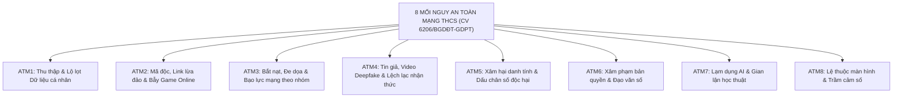
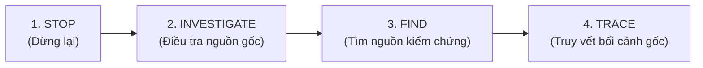
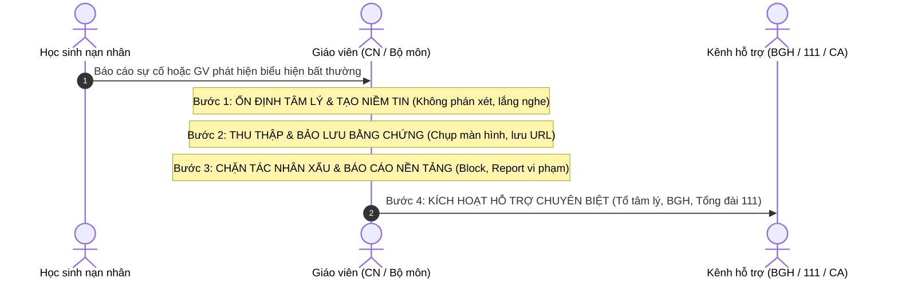
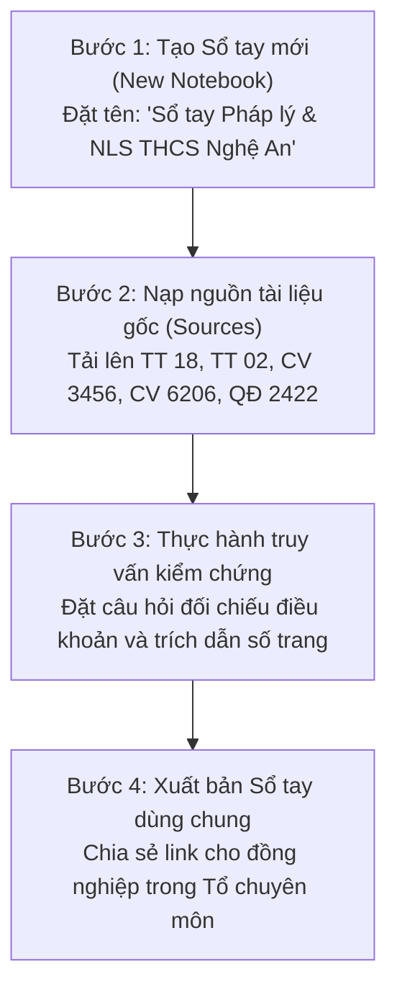

# BỘ GIÁO DỤC VÀ ĐÀO TẠO — HỌC VIỆN QUẢN LÝ GIÁO DỤC
### SỞ GIÁO DỤC VÀ ĐÀO TẠO TỈNH NGHỆ AN
***

# TÀI LIỆU BỒI DƯỠNG NĂNG LỰC SỐ VÀ SƯ PHẠM SỐ THÍCH ỨNG CẤP TRUNG HỌC CƠ SỞ
### *(Tài liệu lưu hành nội bộ phục vụ bồi dưỡng Cán bộ quản lý và Giáo viên THCS tỉnh Nghệ An – Năm học 2026–2027)*

---

## CHUYÊN ĐỀ 2: AN TOÀN MẠNG TOÀN DIỆN, ĐẠO ĐỨC AI & TRA CỨU TRI THỨC CÓ CĂN CỨ

- **Mã chuyên đề:** CĐ-02/THCS-NA
- **Thời lượng:** 04 tiết (180 phút) — Buổi chiều Ngày 1
- **Đối tượng:** Cán bộ quản lý (Hiệu trưởng, Phó Hiệu trưởng), Tổ trưởng chuyên môn và Giáo viên cốt cán cấp THCS
- **Đơn vị phát triển nội dung:** Học viện Quản lý Giáo dục (NAEM) phối hợp Sở GD&ĐT Nghệ An

---

### MỤC LỤC CHUYÊN ĐỀ
1. **MỤC TIÊU BỒI DƯỠNG VÀ CHUẨN ĐẦU RA CHUYÊN ĐỀ**
2. **PHẦN I: NHẬN DIỆN NGUY CƠ AN TOÀN MẠNG ĐẶC THÙ LỨA TUỔI HỌC SINH THCS**
   - 1.1. Đặc điểm tâm lý lứa tuổi 11–14 và các bẫy tâm lý trên không gian mạng
   - 1.2. Phân loại 08 mối nguy an toàn mạng học đường mới (theo Công văn 6206/BGDĐT-GDPT)
   - 1.3. Khung pháp lý bảo vệ dữ liệu trẻ em (Luật 91/2025/QH15 & Luật Trẻ em 2016)
3. **PHẦN II: NGUYÊN TẮC ĐẠO ĐỨC AI VÀ QUY TRÌNH KIỂM CHỨNG THÔNG TIN SIFT**
   - 2.1. Hiện tượng "Ảo giác AI" (AI Hallucination) và bẫy lệ thuộc nhận thức
   - 2.2. Bộ quy tắc đạo đức AI học đường "4 KHÔNG – 3 CÓ" (ATM7)
   - 2.3. Quy trình 4 bước kiểm chứng thông tin số SIFT (Stop – Investigate – Find – Trace)
4. **PHẦN III: QUY TRÌNH ỨNG PHÓ VÀ XỬ LÝ SỰ CỐ AN TOÀN MẠNG HỌC ĐƯỜNG**
   - 3.1. Quy trình ứng phó khẩn cấp 4 bước cấp Lớp học (Dành cho Giáo viên)
   - 3.2. Quy trình xử lý sự cố 7 bước cấp Trường học (Dành cho Ban Giám hiệu)
   - 3.3. Mạng lưới phối hợp liên ngành: Gia đình – Nhà trường – Tổng đài 111 – Công an
5. **PHẦN IV: HƯỚNG DẪN THỰC HÀNH SỔ TAY TRI THỨC SỐ GROUNDED AI TRÊN NOTEBOOKLM**
   - 4.1. Khái niệm Grounded AI (AI có căn cứ trích dẫn)
   - 4.2. Quy trình 4 bước xây dựng Sổ tay pháp lý số trên NotebookLM
   - 4.3. Kỹ thuật truy vấn đối chiếu điều khoản và trích xuất trích dẫn nội tuyến (Inline Citations)
6. **PHẦN V: HỆ THỐNG PROMPT 4 THẺ CHUẨN HÓA VỀ AN TOÀN MẠNG VÀ ĐẠO ĐỨC AI**
   - 5.1. Mẫu Prompt 03: Thiết kế bài tập kiểm chứng tin giả bằng quy trình SIFT
   - 5.2. Mẫu Prompt 04: Soạn thảo kịch bản diễn tập xử lý sự cố lộ lọt dữ liệu học sinh
7. **PHẦN VI: BẢNG TIÊU CHÍ ĐÁNH GIÁ NGHIỆM THU SẢN PHẨM (RUBRIC NHIỆM VỤ 02)**
8. **PHẦN VII: BẢNG KIỂM BÀN GIAO SẢN PHẨM VÀ KẾ HOẠCH HÀNH ĐỘNG CÁ NHÂN**

---

### MỤC TIÊU BỒI DƯỠNG VÀ CHUẨN ĐẦU RA CHUYÊN ĐỀ

#### 1. Về kiến thức
- Nhận diện bản chất, phương thức tấn công tâm lý và dấu hiệu nhận biết của 08 mối nguy an toàn mạng đối với học sinh THCS theo Công văn 6206/BGDĐT-GDPT.
- Nắm vững các điều khoản bắt buộc của Luật Bảo vệ dữ liệu cá nhân số 91/2025/QH15 và Luật Trẻ em 2016 trong việc bảo mật dữ liệu học sinh dưới 16 tuổi.
- Phân tích được cơ chế "Ảo giác" của các mô hình ngôn ngữ lớn (LLMs) và giải pháp kỹ thuật Grounded AI (gắn chặt câu trả lời vào văn bản gốc).

#### 2. Về kỹ năng
- Thành thạo kỹ thuật kiểm chứng nguồn tin 4 bước SIFT để phát hiện tin giả, video Deepfake và thông tin xuyên tạc.
- Vận hành quy trình 4 bước ứng phó sự cố mạng tại lớp học khi phát hiện học sinh bị bắt nạt, tống tiền hoặc phát tán hình ảnh riêng tư.
- Khởi tạo và nạp dữ liệu thành công một "Sổ tay tri thức số" trên NotebookLM với các văn bản quy phạm hiện hành.

#### 3. Về thái độ và văn hóa số
- Tuyệt đối tuân thủ nguyên tắc an toàn tâm lý: Không dùng các tình huống sốc, bạo lực để minh họa; không nêu tên thật hay trường hợp có thật của học sinh trong trường làm ví dụ.
- Thể hiện sự tôn trọng tuyệt đối quyền riêng tư và danh dự cá nhân của học sinh trong mọi hoạt động số.

---

### PHẦN I: NHẬN DIỆN NGUY CƠ AN TOÀN MẠNG ĐẶC THÙ LỨA TUỔI HỌC SINH THCS

#### 1.1. Đặc điểm tâm lý lứa tuổi 11–14 và các bẫy tâm lý trên không gian mạng

Học sinh cấp THCS (11–14 tuổi) đang trải qua giai đoạn khủng hoảng dậy thì với các đặc trưng tâm lý nổi bật:
1. **Nhu cầu khẳng định bản thân cao:** Khao khát sự chú ý, tích lũy lượt like, view, share; dễ bị lôi kéo vào các trào lưu (trend) nguy hiểm trên TikTok, Facebook Reels.
2. **Tâm lý bầy đàn và sợ bị cô lập (FOMO - Fear Of Missing Out):** Dễ a dua tham gia các hội nhóm kín nói xấu, tẩy chay hoặc công kích đồng đẳng.
3. **Khao khát tìm hiểu thế giới nhưng non nớt về kinh nghiệm xã hội:** Dễ tin người, tò mò về giới tính, dễ bị đối tượng xấu dẫn dụ chia sẻ hình ảnh nhạy cảm hoặc mật khẩu cá nhân.

#### 1.2. Phân loại 08 mối nguy an toàn mạng học đường mới (theo Công văn 6206)



*Bảng phân tích chi tiết hành vi và dấu hiệu nhận biết:*

| Mã chuyên đề | Tên mối nguy | Phương thức biểu hiện tại trường THCS | Hậu quả tâm lý / Sư phạm |
| :---: | :--- | :--- | :--- |
| **ATM1** | Lộ lọt dữ liệu cá nhân | Học sinh công khai số điện thoại, địa chỉ nhà, ảnh thẻ học sinh lên mạng xã hội; dùng chung mật khẩu. | Bị tống tiền, mạo danh vay nợ, quấy rối gia đình. |
| **ATM2** | Lừa đảo qua mạng | Bẫy nạp thẻ game giá rẻ, tặng skin miễn phí, bấm vào mã QR/đường link lạ chứa mã độc đánh cắp tài khoản. | Mất tài khoản mạng xã hội, lây lan mã độc cho bạn bè. |
| **ATM3** | Bắt nạt mạng (Cyberbullying) | Lập group chat kín tẩy chay, chế ảnh dìm hàng, dùng từ ngữ miệt thị ngoại hình (body shaming) công khai. | Học sinh hoảng loạn, sợ đến trường, có nguy cơ trầm cảm. |
| **ATM4** | Tin giả & Deepfake | Nghe theo video AI cắt ghép bôi nhọ lãnh đạo, quảng cáo thuốc lá điện tử, tin đồn giật gân sai sự thật. | Hoang mang dư luận, suy giảm niềm tin, vi phạm pháp luật. |
| **ATM5** | Dấu chân số tiêu cực | Đăng bình luận chửi bậy, tham gia chửi nhau trên mạng để lại lịch sử vết tích số độc hại lâu dài. | Ảnh hưởng tiêu cực đến hồ sơ học tập và tương lai. |
| **ATM6** | Xâm phạm bản quyền | Cắt ghép tranh ảnh, video clip, bài văn của người khác làm sản phẩm học tập của mình mà không ghi nguồn. | Hình thành thói quen gian dối, vi phạm Luật Sở hữu trí tuệ. |
| **ATM7** | Ảo giác AI & Gian lận | Nhờ AI làm trọn gói bài tập về nhà; sao chép nguyên văn thông tin sai lệch do AI bịa đặt. | Thui chột tư duy phản biện, mất kỹ năng diễn đạt tự thân. |
| **ATM8** | Lệ thuộc thiết bị số | Chơi game thâu đêm, lướt video ngắn liên tục, mất tập trung trong giờ học, cáu gắt khi bị thu điện thoại. | Sa sút thể lực, suy giảm thị lực, mất kết nối gia đình. |

#### 1.3. Khung pháp lý bảo vệ dữ liệu trẻ em (Luật 91/2025/QH15 & Luật Trẻ em 2016)

- **Điều 54, 55 Luật Trẻ em 2016:** Nghiêm cấm hành vi công bố, tiết lộ thông tin về đời sống riêng tư, bí mật cá nhân của trẻ em mà không được sự đồng ý của cha, mẹ hoặc người giám hộ và sự đồng ý của trẻ em từ đủ 7 tuổi trở lên.
- **Luật Bảo vệ dữ liệu cá nhân số 91/2025/QH15:**
  1. Dữ liệu học tập, hình ảnh khuôn mặt, thông tin phụ huynh của học sinh là dữ liệu cá nhân được pháp luật bảo vệ nghiêm ngặt.
  2. Nhà trường và giáo viên khi tổ chức khảo sát hoặc đăng tải hoạt động lên mạng xã hội bắt buộc phải **Ẩn danh hóa (Anonymization)**: Che mờ khuôn mặt, xóa mã định danh, không công khai danh sách điểm số kèm tên tuổi đầy đủ.
  3. Tuyệt đối **KHÔNG yêu cầu học sinh dưới 16 tuổi tự tạo tài khoản AI** đòi hỏi khai báo số điện thoại cá nhân.

---

### PHẦN II: NGUYÊN TẮC ĐẠO ĐỨC AI VÀ QUY TRÌNH KIỂM CHỨNG THÔNG TIN SIFT

#### 2.1. Hiện tượng "Ảo giác AI" (AI Hallucination) và bẫy lệ thuộc nhận thức

Các mô hình AI tạo sinh (như Gemini, ChatGPT) hoạt động dựa trên cơ chế dự đoán xác suất từ tiếp theo, không phải là cơ sở dữ liệu chân lý tuyệt đối. Do đó, AI có thể:
- Bịa đặt ra tên tác giả, năm ban hành hoặc số hiệu văn bản pháp luật không có thật với giọng điệu vô cùng tự tin.
- Tạo ra các công thức khoa học sai lệch hoặc trích dẫn các tài liệu nghiên cứu giả mạo.

*Thông điệp sư phạm chốt lại cho học sinh:* **"AI là trợ lý gợi mở ý tưởng, con người mới là người kiểm chứng và chịu trách nhiệm cuối cùng."**

#### 2.2. Bộ quy tắc đạo đức AI học đường "4 KHÔNG – 3 CÓ" (ATM7)

Bộ quy tắc chuẩn mực được quy định dán tại 100% phòng máy vi tính và bảng tin học tập của các trường THCS:

```
┌────────────────────────────────────────────────────────────────────────┐
│                   BỘ QUY TẮC ĐẠO ĐỨC AI HỌC ĐƯỜNG                      │
│                    "4 KHÔNG – 3 CÓ" (CHUẨN 2026)                       │
├────────────────────────────────────────────────────────────────────────┤
│ ❌ 4 KHÔNG (CÁC ĐIỀU NGHIÊM CẤM):                                      │
│ 1. KHÔNG nạp thông tin cá nhân: Họ tên, mật khẩu, địa chỉ, ảnh riêng   │
│    tư của bản thân, thầy cô hay bạn bè vào các phần mềm AI.           │
│ 2. KHÔNG nhờ AI làm hộ: Không yêu cầu AI giải trọn gói bài tập, viết hộ│
│    bài văn để nộp lấy điểm (gian lận học thuật).                       │
│ 3. KHÔNG tin tưởng mù quáng: Không bao giờ tin 100% câu trả lời của AI │
│    khi chưa đối chiếu với Sách giáo khoa và tài liệu chuẩn xác.        │
│ 4. KHÔNG dùng AI hại người: Nghiêm cấm dùng AI chế ảnh bôi nhọ, giả    │
│    giọng nói (Deepfake) để trêu chọc, đe dọa hoặc bắt nạt người khác. │
├────────────────────────────────────────────────────────────────────────┤
│ ✅ 3 CÓ (CÁC HÀNH VI ĐƯỢC KHUYẾN KHÍCH):                               │
│ 1. CÓ dùng AI làm trợ lý ý tưởng: Dùng AI để tìm cảm hứng, gợi ý đề   │
│    cương, tóm tắt bài đọc và tìm kiếm câu hỏi ôn tập.                  │
│ 2. CÓ kiểm chứng và phản biện: Luôn đặt câu hỏi "Thông tin này lấy từ │
│    đâu?" và chủ động phát hiện lỗi sai, thiên kiến của AI.             │
│ 3. CÓ minh bạch nguồn gốc: Luôn chú thích rõ ràng "Bài làm có sử dụng  │
│    gợi ý từ công cụ AI..." trong sản phẩm học tập của mình.            │
└────────────────────────────────────────────────────────────────────────┘
```

#### 2.3. Quy trình 4 bước kiểm chứng thông tin số SIFT (Stop – Investigate – Find – Trace)

Quy trình SIFT (do chuyên gia Mike Caulfield phát triển, được Bộ GD&ĐT chuẩn hóa tại Công văn 6206) là công cụ phòng vệ tư duy hữu hiệu nhất:



1. **Bước 1: STOP (Dừng lại):** Khi đọc một thông tin giật gân, gây sốc, phẫn nộ hoặc quá kỳ lạ, không được like, share hay bình luận ngay. Hãy tạm dừng để kiểm soát cảm xúc.
2. **Bước 2: INVESTIGATE THE SOURCE (Điều tra nguồn):** Trang web này là của ai? Tên miền có dấu hiệu giả mạo không (ví dụ: `.com.vn` bị đổi thành `.top`, `.xyz`)? Tác giả là ai, có chuyên môn không?
3. **Bước 3: FIND TRUSTED COVERAGE (Tìm nguồn tin cậy):** Các cơ quan báo chí chính thống (VTV, Báo Nhân Dân, Báo Nghệ An, Cổng TTĐT Bộ GD&ĐT) có đưa tin về sự việc này không?
4. **Bước 4: TRACE CLAIMS (Truy vết bối cảnh gốc):** Dùng tính năng Google Search Images hoặc tìm kiếm ngược để xem hình ảnh/video clip này xuất hiện từ bao giờ, có bị cắt ghép hay là sản phẩm của AI Deepfake hay không.

---

### PHẦN III: QUY TRÌNH ỨNG PHÓ VÀ XỬ LÝ SỰ CỐ AN TOÀN MẠNG HỌC ĐƯỜNG

#### 3.1. Quy trình ứng phó khẩn cấp 4 bước cấp Lớp học (Dành cho Giáo viên)

Khi phát hiện học sinh bị bắt nạt mạng, bị phát tán hình ảnh riêng tư hoặc vướng vào sự cố lừa đảo, giáo viên chủ nhiệm / bộ môn tuân thủ quy trình 4 bước:



- **Bước 1: Nhận diện & Trấn an tâm lý:** Lắng nghe học sinh trong không gian kín đáo, riêng tư; tuyệt đối không la mắng, chỉ trích hay đổ lỗi cho nạn nhân. Đảm bảo nguyên tắc bảo mật.
- **Bước 2: Thu thập và bảo lưu chứng cứ:** Hướng dẫn chụp ảnh màn hình tin nhắn, bài đăng bôi nhọ, ghi lại đường link URL, số điện thoại, tài khoản của kẻ bắt nạt/lừa đảo trước khi chúng bị xóa.
- **Bước 3: Chặn tương tác và Báo cáo vi phạm:** Hướng dẫn học sinh bấm "Chặn" (Block) tài khoản quấy rối; báo cáo (Report) bài viết vi phạm lên quản trị viên mạng xã hội hoặc nhóm lớp.
- **Bước 4: Tìm kiếm trợ giúp chuyên môn:** Báo cáo ngay cho Ban Giám hiệu, liên hệ phụ huynh và kết nối với Tổ tư vấn tâm lý học đường. Khi có dấu hiệu tội phạm nghiêm trọng (tống tiền, cưỡng đoạt, xâm hại tình dục trẻ em), gọi ngay **Tổng đài Quốc gia Bảo vệ Trẻ em 111** hoặc Công an xã/phường (113).

#### 3.2. Quy trình xử lý sự cố 7 bước cấp Trường học (Dành cho Ban Giám hiệu)

Đối với các sự cố an toàn thông tin hoặc bạo lực mạng quy mô toàn trường, Ban Giám hiệu vận hành quy trình 7 bước chuẩn:
1. **Tiếp nhận & Xác minh:** Tiếp nhận thông tin từ các kênh, thẩm định mức độ nghiêm trọng.
2. **Cách ly & Khống chế:** Thu hồi bài viết, yêu cầu các bên liên quan gỡ bỏ nội dung, ngăn chặn sự lan truyền.
3. **Bảo vệ nạn nhân:** Cử cán bộ tâm lý chăm sóc sức khỏe tinh thần, bố trí người đồng hành.
4. **Phối hợp gia đình:** Mời cha mẹ học sinh hai bên làm việc trên tinh thần giáo dục, hàn gắn.
5. **Báo cáo cấp trên:** Gửi báo cáo nhanh bằng văn bản bảo mật lên Phòng GD&ĐT và cơ quan chức năng.
6. **Xử lý giáo dục:** Áp dụng các biện pháp kỷ luật tích cực, giáo dục hành vi thay vì trừng phạt công khai.
7. **Rà soát & Phòng ngừa:** Tổ chức sinh hoạt chuyên đề toàn trường rút kinh nghiệm và bịt lỗ hổng an toàn mạng.

---

### PHẦN IV: HƯỚNG DẪN THỰC HÀNH SỔ TAY TRI THỨC SỐ GROUNDED AI TRÊN NOTEBOOKLM

#### 4.1. Khái niệm Grounded AI (AI có căn cứ trích dẫn)

**NotebookLM** là công cụ AI nghiên cứu của Google áp dụng công nghệ Grounded AI:
- Công cụ chỉ trả lời câu hỏi dựa trên **các tài liệu mà người dùng trực tiếp tải lên** (PDF, Docs, Link web).
- Tuyệt đối không tự bịa đặt thông tin từ bên ngoài.
- Mỗi câu trả lời đều có đính kèm **Trích dẫn nội tuyến (Inline Citations)**: Bấm vào số trích dẫn sẽ nhảy thẳng đến đoạn văn bản, số trang của tài liệu gốc.

#### 4.2. Quy trình 4 bước xây dựng Sổ tay pháp lý số trên NotebookLM



#### 4.3. Kỹ thuật truy vấn đối chiếu điều khoản và trích xuất trích dẫn nội tuyến

*Bảng các câu lệnh (Queries) mẫu giáo viên thực hành:*

| Mục đích nghiệp vụ | Câu lệnh truy vấn mẫu trên NotebookLM | Kết quả kiểm chứng mong đợi |
| :--- | :--- | :--- |
| **Tra cứu chuẩn giáo viên** | *"Hãy liệt kê 06 miền năng lực số của giáo viên theo Thông tư 18/2026/TT-BGDĐT và chỉ rõ các hành vi thuộc Miền 4 về an toàn mạng?"* | Trả lời chính xác tên 6 miền, trích dẫn Điều 4, 5 kèm số hiệu văn bản; có icon trích dẫn số trang. |
| **Tra cứu chuẩn học sinh** | *"Theo Công văn 3456/BGDĐT-GDPT, học sinh lớp 7 cần đạt những chỉ báo nào ở năng lực An toàn thông tin (Bậc TC1)?"* | Liệt kê các mã TC1.x tương ứng lứa tuổi lớp 6–7, không bị nhầm lẫn sang chuẩn THPT. |
| **Tra cứu quy định trẻ em** | *"Quy định về bảo vệ dữ liệu cá nhân học sinh dưới 16 tuổi trong Luật 91/2025/QH15 và Luật Trẻ em gồm những điểm cốt lõi nào?"* | Nêu bật nguyên tắc đồng ý của phụ huynh, cấm tiết lộ thông tin đời tư; dẫn chứng điều khoản luật. |

---

### PHẦN V: HỆ THỐNG PROMPT 4 THẺ CHUẨN HÓA VỀ AN TOÀN MẠNG VÀ ĐẠO ĐỨC AI

#### 5.1. Mẫu Prompt 03: Thiết kế bài tập kiểm chứng tin giả bằng quy trình SIFT

```markdown
[Ngữ cảnh]
Tôi là giáo viên THCS tại Nghệ An, đang giảng dạy môn [TÊN MÔN HỌC: GDCD / Ngữ văn / KHTN / HĐTN-HN] lớp [6/7/8/9]. Tôi muốn thiết kế một hoạt động học tập thực chiến giúp học sinh rèn luyện kỹ năng kiểm chứng thông tin và phòng chống tin giả trên mạng xã hội theo quy trình 4 bước SIFT và chuyên đề ATM4 (Công văn 6206/BGDĐT-GDPT).

[Dữ liệu/điều kiện]
- Tình huống giả định: Một bài đăng trên mạng xã hội Facebook/TikTok giật tít cảnh báo về một hiện tượng thời tiết cực đoan hoặc một sản phẩm đồ ăn vặt gây ngộ độc tại cổng trường học ở một huyện của tỉnh Nghệ An, kèm theo hình ảnh cắt ghép gây hoang mang dư luận.
- Ràng buộc nhân văn: Tình huống hoàn toàn giả định, không sử dụng tên thật của trường học hay học sinh nào; không dùng hình ảnh gây sốc hay phản cảm; đảm bảo phù hợp lứa tuổi THCS.
- Khung quy chiếu: Quy trình 4 bước SIFT (Stop - Dừng lại, Investigate - Điều tra nguồn, Find - Tìm nguồn tin cậy, Trace - Truy vết bối cảnh gốc).

[Hướng dẫn]
1. Hãy soạn thảo nội dung bài đăng giả định chi tiết (gồm tiêu đề, nội dung text giật gân, mô tả hình ảnh đính kèm và các dấu hiệu bất thường tinh vi).
2. Thiết kế Phiếu học tập thực hành SIFT: Chia thành 4 cột tương ứng 4 bước, trong mỗi bước nêu rõ các câu hỏi gợi ý để học sinh làm việc nhóm và đưa ra kết luận.
3. Cung cấp đáp án sư phạm chi tiết: Chỉ rõ các "vết tích giả tạo" trong bài đăng và hướng xử lý chuẩn mực (báo cáo vi phạm, không lan truyền).
4. Thiết kế 01 thông điệp đạo đức số ngắn gọn (dưới 50 từ) để học sinh ghi nhớ sau bài học.

[Kết quả mong muốn]
- Định dạng xuất bản: Phiếu học tập định dạng Markdown chuẩn mực, có bảng biểu rõ ràng, sẵn sàng in ra phát cho các nhóm học sinh.
- Ngôn ngữ: Gần gũi, phù hợp với tâm lý lứa tuổi 11-14 tuổi nhưng đảm bảo tính sư phạm nghiêm túc.
```

#### 5.2. Mẫu Prompt 04: Soạn thảo kịch bản diễn tập xử lý sự cố lộ lọt dữ liệu học sinh

```markdown
[Ngữ cảnh]
Tôi là Cán bộ quản lý / Tổ trưởng chuyên môn tại một trường THCS tỉnh Nghệ An. Tôi cần xây dựng một kịch bản diễn tập mô phỏng quy trình xử lý sự cố an toàn thông tin mạng cấp trường, phục vụ buổi sinh hoạt chuyên môn định kỳ và bồi dưỡng kỹ năng cho toàn thể giáo viên trong trường.

[Dữ liệu/điều kiện]
- Bối cảnh sự cố: Một giáo viên vô tình tải bức ảnh chụp bảng danh sách học sinh (có đầy đủ họ tên, ngày sinh, điểm số và số điện thoại phụ huynh) lên nhóm Zalo lớp công khai, sau đó danh sách này bị một đối tượng xấu chia sẻ ra các hội nhóm ngoài trường để gọi điện lừa đảo phụ huynh.
- Khung pháp lý: Luật Bảo vệ dữ liệu cá nhân 91/2025/QH15, Luật Trẻ em 2016 và Quy trình ứng phó 7 bước cấp trường theo Công văn 6206/BGDĐT-GDPT.
- Yêu cầu: Không quy kết trách nhiệm cá nhân mang tính trừng phạt; tập trung vào tiến trình xử lý khủng hoảng, bảo vệ dữ liệu học sinh và hàn gắn niềm tin của phụ huynh.

[Hướng dẫn]
1. Hãy phân tích mức độ vi phạm và các nguy cơ pháp lý phát sinh từ tình huống trên.
2. Xây dựng kịch bản ứng phó 7 bước chi tiết theo mốc thời gian: Giờ thứ 1 (Cách ly khẩn cấp) -> Giờ thứ 2 (Bảo vệ nạn nhân & Phối hợp phụ huynh) -> Giờ thứ 24 (Báo cáo cấp trên & Xử lý kỹ thuật) -> Tuần tiếp theo (Rà soát hệ thống).
3. Soạn thảo mẫu Thông báo chính thức của Ban Giám hiệu gửi tới phụ huynh học sinh (ngắn gọn, chân thành, minh bạch, hướng dẫn phụ huynh cách cảnh giác trước các cuộc gọi lừa đảo).
4. Đề xuất 03 biện pháp kỹ thuật và quy chế nội bộ bắt buộc phải ban hành ngay sau sự cố để không tái diễn.

[Kết quả mong muốn]
- Định dạng: Bản kế hoạch hành động chuyên nghiệp, có bảng phân công trách nhiệm RACI rõ ràng.
- Ngôn ngữ: Khúc chiết, chuẩn mực quản lý giáo dục, mang tính phòng ngừa và xây dựng văn hóa số an toàn.
```

---

### PHẦN VI: BẢNG TIÊU CHÍ ĐÁNH GIÁ NGHIỆM THU SẢN PHẨM (RUBRIC NHIỆM VỤ 02)

| Tiêu chí đánh giá | Mức 1: Không đạt<br>(Dưới 50% yêu cầu) | Mức 2: Cần hoàn thiện<br>(50% - 74% yêu cầu) | Mức 3: Đạt chuẩn<br>(75% - 89% yêu cầu) | Mức 4: Xuất sắc<br>(90% - 100% yêu cầu) |
| :--- | :--- | :--- | :--- | :--- |
| **Tiêu chí 1:<br>Cấu hình Sổ tay NotebookLM** *(Trọng số: 30%)* | Không nạp được tài liệu hoặc nạp sai văn bản pháp quy; câu trả lời không có trích dẫn nội tuyến. | Nạp đủ tài liệu nhưng chỉ tra cứu được các câu hỏi đơn giản; chưa biết đối chiếu liên văn bản. | Nạp chuẩn xác 05 văn bản cốt lõi; tra cứu thông thạo; 100% câu trả lời có số trang và điều khoản chứng minh. | Khai thác chuyên sâu NotebookLM; tạo lập được các bảng tóm tắt so sánh liên văn bản xuất sắc; chia sẻ hiệu quả cho tổ. |
| **Tiêu chí 2:<br>Quy trình kiểm chứng SIFT** *(Trọng số: 25%)* | Không nắm vững 4 bước SIFT; bài tập tình huống mang tính lý thuyết, xa rời thực tế học sinh THCS. | Thiết kế được bài tập SIFT nhưng các câu hỏi gợi mở còn mơ hồ, học sinh khó thao tác kiểm chứng. | Thiết kế bài tập SIFT chuẩn xác; tình huống sinh động gắn liền với địa phương Nghệ An; đáp án sư phạm chặt chẽ. | Bài tập SIFT xuất sắc, sáng tạo; kích thích tư duy phản biện cao; học sinh hào hứng tham gia kiểm chứng thực chiến. |
| **Tiêu chí 3:<br>Quy trình ứng phó sự cố ATM** *(Trọng số: 25%)* | Bỏ qua bước ổn định tâm lý; đề xuất giải pháp xử phạt nặng nề, thiếu tính nhân văn sư phạm; vi phạm bảo mật. | Nêu được các bước cơ bản nhưng lúng túng khi phối hợp liên ngành (thiếu thông tin Tổng đài 111, Công an). | Nắm vững quy trình 4 bước lớp học và 7 bước cấp trường; lấy bảo vệ an toàn học sinh làm trung tâm xử lý. | Kịch bản ứng phó bài bản, chuẩn pháp lý; có phương án truyền thông khủng hoảng và phục hồi tâm lý học đường toàn diện. |
| **Tiêu chí 4:<br>Đạo đức AI & Bảo vệ dữ liệu** *(Trọng số: 20%)* | Còn yêu cầu học sinh dưới 16 tuổi đăng ký tài khoản AI; thu thập thông tin định danh trái luật. | Bộ quy tắc 4 Không - 3 Có chưa được cụ thể hóa vào hoàn cảnh nhà trường; còn mang tính hình thức. | 100% tuân thủ Luật 91/2025/QH15; ban hành Bộ quy tắc 4 Không - 3 Có rõ ràng, dễ nhớ, dán tại phòng máy. | Văn hóa an toàn dữ liệu và đạo đức AI được chuyển hóa thành quy chế học đường mẫu mực; học sinh tự giác thực hiện. |

---

### PHẦN VII: BẢNG KIỂM BÀN GIAO SẢN PHẨM VÀ KẾ HOẠCH HÀNH ĐỘNG CÁ NHÂN

#### 1. Bảng kiểm (Checklist) hồ sơ đầu ra Buổi 2
- [ ] **Sản phẩm 1:** Link 01 Sổ tay tri thức số NotebookLM nạp đủ 05 văn bản pháp quy gốc của Bộ GD&ĐT.
- [ ] **Sản phẩm 2:** 01 Bản Quy tắc Đạo đức AI & An toàn mạng "4 KHÔNG – 3 CÓ" dán phòng máy vi tính.
- [ ] **Sản phẩm 3:** 01 Kịch bản bài tập thực hành kiểm chứng tin giả bằng quy trình SIFT 4 bước.
- [ ] **Sản phẩm 4:** 01 Sơ đồ quy trình ứng phó sự cố mạng 4 bước (cấp lớp) và 7 bước (cấp trường) in sẵn.
- [ ] **Sản phẩm 5:** Cam kết 100% ẩn danh hóa dữ liệu học sinh trong mọi hồ sơ chuyên môn của tổ.

---
**NGÀY HOÀN THÀNH BIÊN SOẠN:** Năm học 2026–2027  
**CƠ QUAN CHỦ TRÌ:** Học viện Quản lý Giáo dục (NAEM) & Sở Giáo dục và Đào tạo tỉnh Nghệ An  
