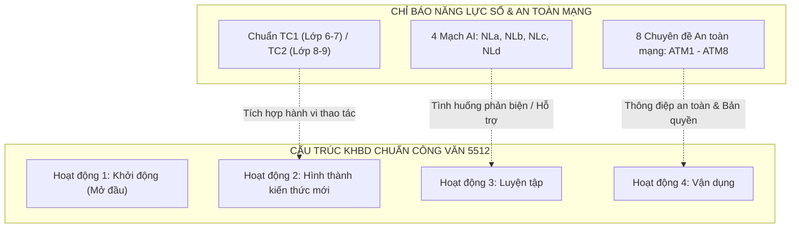
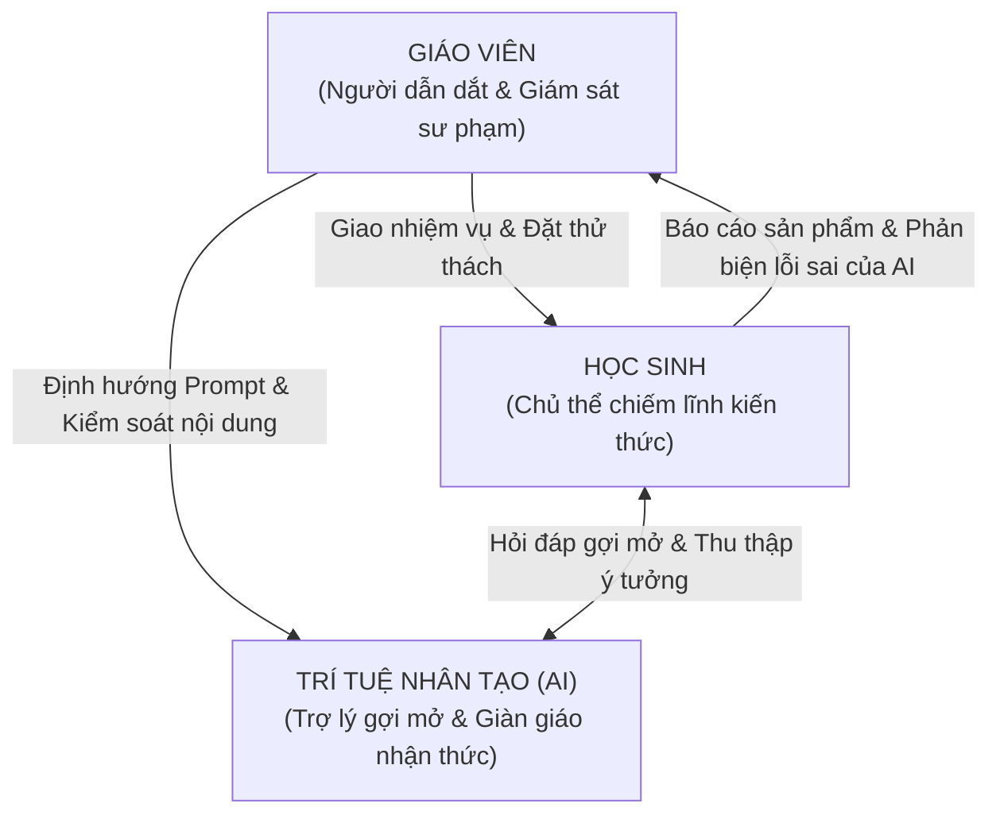
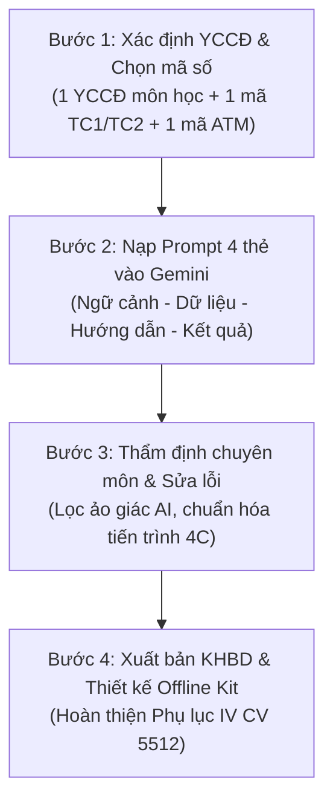

# BỘ GIÁO DỤC VÀ ĐÀO TẠO — HỌC VIỆN QUẢN LÝ GIÁO DỤC
### SỞ GIÁO DỤC VÀ ĐÀO TẠO TỈNH NGHỆ AN
***

# TÀI LIỆU BỒI DƯỠNG NĂNG LỰC SỐ VÀ SƯ PHẠM SỐ THÍCH ỨNG CẤP TRUNG HỌC CƠ SỞ
### *(Tài liệu lưu hành nội bộ phục vụ bồi dưỡng Cán bộ quản lý và Giáo viên THCS tỉnh Nghệ An – Năm học 2026–2027)*

---

## CHUYÊN ĐỀ 3: SƯ PHẠM SỐ THÍCH ỨNG & THIẾT KẾ KẾ HOẠCH BÀI DẠY TÍCH HỢP 4C CHUẨN CV 5512

- **Mã chuyên đề:** CĐ-03/THCS-NA
- **Thời lượng:** 04 tiết (180 phút) — Buổi sáng Ngày 2
- **Đối tượng:** Cán bộ quản lý (Hiệu trưởng, Phó Hiệu trưởng), Tổ trưởng chuyên môn và Giáo viên cốt cán cấp THCS
- **Đơn vị phát triển nội dung:** Học viện Quản lý Giáo dục (NAEM) phối hợp Sở GD&ĐT Nghệ An

---

### MỤC LỤC CHUYÊN ĐỀ
1. **MỤC TIÊU BỒI DƯỠNG VÀ CHUẨN ĐẦU RA CHUYÊN ĐỀ**
2. **PHẦN I: NGUYÊN TẮC TÍCH HỢP SƯ PHẠM SỐ KHÔNG PHÁT SINH TIẾT HỌC MỚI**
   - 1.1. Bản chất của "Tích hợp số đúng địa chỉ" trong Chương trình GDPT 2018
   - 1.2. Mối liên kết giữa Phụ lục IV (Công văn 5512) với Chuẩn NLS (TC1/TC2) và An toàn mạng (ATM)
   - 1.3. Mô hình tương tác sư phạm 3 chiều: Giáo viên – Học sinh – AI
3. **PHẦN II: MÔ HÌNH TIẾN TRÌNH DẠY HỌC KỂ CHUYỆN 4C TRONG MÔI TRƯỜNG SỐ**
   - 2.1. Cấu trúc mô hình 4C: Context – Challenge – Concept – Conclusion
   - 2.2. Ánh xạ 4C vào 4 hoạt động học chuẩn của Công văn số 5512/BGDĐT-GDTrH
   - 2.3. Kỹ thuật phân tầng nhiệm vụ 3 mức độ (Nhóm A – Nhóm B – Nhóm C) trong cùng một lớp học
4. **PHẦN III: THIẾT KẾ PHƯƠNG ÁN SƯ PHẠM THÍCH ỨNG NGOẠI TUYẾN (OFFLINE KIT)**
   - 3.1. Nguyên lý công bằng tiếp cận công nghệ tại các điểm trường khó khăn Nghệ An
   - 3.2. Cấu trúc một bộ Phiếu học tập Offline Kit dự phòng chuẩn hóa
   - 3.3. Quy trình chuyển đổi linh hoạt kịch bản 3 phút (Online ↔ Offline)
5. **PHẦN IV: QUY TRÌNH 4 BƯỚC THIẾT KẾ KHBD 4C BẰNG PROMPT 4 THẺ CHUẨN HÓA**
   - 4.1. Bước 1: Xác định Yêu cầu cần đạt cốt lõi và lựa chọn mã chỉ báo NLS/ATM phù hợp
   - 4.2. Bước 2: Viết câu lệnh Prompt 4 thẻ sư phạm nạp vào Google Gemini
   - 4.3. Bước 3: Rà soát, hiệu chỉnh chuyên môn, loại bỏ ảo giác AI và bổ sung Offline Kit
   - 4.4. Bước 4: Hoàn thiện hồ sơ KHBD chuẩn Phụ lục IV Công văn 5512
6. **PHẦN V: HỆ THỐNG PROMPT 4 THẺ MẪU SOẠN GIÁO ÁN TÍCH HỢP**
   - 5.1. Mẫu Prompt 05: Soạn KHBD 4C tích hợp NLS và AI môn Khoa học tự nhiên
   - 5.2. Mẫu Prompt 06: Soạn KHBD 4C tích hợp NLS và An toàn mạng môn Ngữ văn
7. **PHẦN VI: BẢNG TIÊU CHÍ ĐÁNH GIÁ NGHIỆM THU KHBD (RUBRIC NHIỆM VỤ 03)**
8. **PHẦN VII: BẢNG KIỂM BÀN GIAO SẢN PHẨM VÀ KẾ HOẠCH HÀNH ĐỘNG CÁ NHÂN**

---

### MỤC TIÊU BỒI DƯỠNG VÀ CHUẨN ĐẦU RA CHUYÊN ĐỀ

#### 1. Về kiến thức
- Nắm vững cấu trúc mô hình tiến trình bài học 4C (Context - Challenge - Concept - Conclusion) và cơ chế lồng ghép tự nhiên vào 04 hoạt động chuẩn của Công văn 5512/BGDĐT-GDTrH.
- Hiểu rõ nguyên lý tương tác 3 chiều (GV - HS - AI), xác định rõ AI là "giàn giáo nhận thức" (Scaffolding Tool) kích thích học sinh tư duy, không phải công cụ làm thay.
- Nắm vững kỹ thuật phân hóa dạy học 3 tầng (Củng cố nền tảng - Thực hành chuẩn - Vận dụng mở rộng) trên cùng một bài học.

#### 2. Về kỹ năng
- Vận dụng thành thạo mô hình Prompt 4 thẻ sư phạm trên Google Gemini để soạn thảo Kế hoạch bài dạy chất lượng cao trong thời gian tối ưu.
- Lồng ghép chính xác các mã chỉ báo NLS học sinh THCS (TC1.x cho lớp 6-7, TC2.x cho lớp 8-9) và các chuyên đề an toàn mạng (ATM1-ATM8) vào tiến trình bài dạy.
- Xây dựng hoàn chỉnh phương án dự phòng ngoại tuyến (Offline Kit) với phiếu học tập in sẵn tương thích 100% với kịch bản số.

#### 3. Về thái độ và văn hóa sư phạm
- Kiên định nguyên tắc sư phạm tích hợp không tăng tiết, bảo vệ quyền lợi được học tập bình đẳng của học sinh vùng đồng bào dân tộc thiểu số và miền núi Nghệ An.
- Thể hiện tinh thần đổi mới sáng tạo, làm chủ công nghệ, không phó mặc chuyên môn cho các ứng dụng trí tuệ nhân tạo.

---

### PHẦN I: NGUYÊN TẮC TÍCH HỢP SƯ PHẠM SỐ KHÔNG PHÁT SINH TIẾT HỌC MỚI

#### 1.1. Bản chất của "Tích hợp số đúng địa chỉ" trong Chương trình GDPT 2018

Nhiều giáo viên lo ngại rằng việc đưa năng lực số, giáo dục AI và an toàn mạng vào nhà trường sẽ làm quá tải chương trình, phát sinh thêm tiết học hoặc gây xáo trộn thời khóa biểu. Chương trình bồi dưỡng khẳng định nguyên tắc pháp lý bất biến:

1. **Không phát sinh tiết học mới:** Năng lực số không phải là một môn học riêng biệt (ngoại trừ môn Tin học trang bị kiến thức nền tảng). NLS là năng lực cốt lõi được hình thành thông qua quá trình học sinh sử dụng công nghệ để giải quyết các nhiệm vụ của môn học sẵn có (Toán, KHTN, Ngữ văn, Lịch sử - Địa lí, GDCD, Công nghệ, HĐTN-HN).
2. **Tích hợp đúng "địa chỉ":** Mỗi bài học chỉ chọn lọc từ **01 đến tối đa 02 chỉ báo NLS hoặc ATM** có mối liên hệ tự nhiên nhất với nội dung bài học. Tuyệt đối không gượng ép đưa tất cả các mã vào một tiết dạy 45 phút.
3. **Mục tiêu môn học là tối thượng:** Công nghệ số chỉ đóng vai trò là phương tiện hỗ trợ giúp học sinh chiếm lĩnh kiến thức bộ môn sâu sắc hơn, trực quan hơn và hứng thú hơn.

#### 1.2. Mối liên kết giữa Phụ lục IV (Công văn 5512) với Chuẩn NLS và ATM



#### 1.3. Mô hình tương tác sư phạm 3 chiều: Giáo viên – Học sinh – AI



- **Giáo viên:** Không đứng ngoài cuộc nhìn học sinh dùng máy tính; giáo viên là người kiến tạo tình huống học tập, đặt ra các câu hỏi kích thích tư duy và hướng dẫn học sinh phát hiện điểm sai, điểm thiên kiến của AI.
- **Học sinh:** Chủ động tương tác, đặt câu hỏi, sử dụng AI để giải phóng các thao tác lặp lại (vẽ hình cơ bản, tìm kiếm tư liệu sơ cấp) để tập trung năng lượng vào phân tích, so sánh và sáng tạo.
- **AI:** Đóng vai trò đối tác học tập (Learning Companion); cung cấp góc nhìn đa chiều nhưng luôn chịu sự kiểm chứng của con người.

---

### PHẦN II: MÔ HÌNH TIẾN TRÌNH DẠY HỌC KỂ CHUYỆN 4C TRONG MÔI TRƯỜNG SỐ

#### 2.1. Cấu trúc mô hình 4C: Context – Challenge – Concept – Conclusion

Mô hình 4C được thiết kế theo mạch cảm xúc và nhận thức tự nhiên của học sinh lứa tuổi THCS:

```
┌────────────────────────────────────────────────────────────────────────┐
│                   MÔ HÌNH TIẾN TRÌNH DẠY HỌC 4C                        │
├────────────────────────────────────────────────────────────────────────┤
│ 1. CONTEXT (Bối cảnh kết nối):                                         │
│ Xuất phát từ một câu chuyện thực tế gần gũi tại Nghệ An hoặc một video │
│ ngắn đặt vấn đề, kích hoạt tò mò và nhu cầu nhận thức của học sinh.    │
├────────────────────────────────────────────────────────────────────────┤
│ 2. CHALLENGE (Thử thách sư phạm số):                                   │
│ Giao nhiệm vụ có tính thách thức: Học sinh phải thao tác với công nghệ  │
│ hoặc phân tích câu trả lời của AI để tìm ra mâu thuẫn nhận thức.       │
├────────────────────────────────────────────────────────────────────────┤
│ 3. CONCEPT (Chiếm lĩnh bản chất khoa học):                             │
│ Học sinh làm việc nhóm, thảo luận, đối chiếu SGK, giáo viên chốt kiến  │
│ thức bản chất; chỉ ra lỗi sai/ảo giác của AI để khắc sâu khái niệm.    │
├────────────────────────────────────────────────────────────────────────┤
│ 4. CONCLUSION (Tổng kết & Phản tư số):                                 │
│ Đúc kết bài học, gắn với thông điệp an toàn mạng (ATM) và vận dụng     │
│ giải quyết vấn đề đời sống; đánh giá sản phẩm qua Rubric/Checklist.    │
└────────────────────────────────────────────────────────────────────────┘
```

#### 2.2. Ánh xạ 4C vào 4 hoạt động học chuẩn của Công văn số 5512

| Mô hình 4C | Hoạt động chuẩn CV 5512 | Mục tiêu sư phạm cốt lõi | Hành vi số & Tương tác công nghệ |
| :---: | :--- | :--- | :--- |
| **C1: Context** | Hoạt động 1: Khởi động (5–7 phút) | Tạo tâm thế học tập, kích hoạt kiến thức nền tảng, tạo xung đột nhận thức. | Xem video clip Micro-learning 1–2 phút hoặc tham gia câu hỏi trắc nghiệm tương tác nhanh (Mentimeter/Plickers). |
| **C2: Challenge** | Hoạt động 2: Khám phá / Hình thành kiến thức (15–20 phút) | Tự lực giải quyết vấn đề, hợp tác nhóm khám phá tri thức mới. | Thao tác mô phỏng ảo (PhET, GeoGebra), tra cứu nguồn mở có kiểm chứng, dùng AI tạo gợi ý ban đầu. |
| **C3: Concept** | Hoạt động 3: Luyện tập (10–12 phút) | Củng cố kiến thức, rèn luyện kỹ năng giải quyết bài tập chuẩn hóa. | So sánh bài làm nhóm với câu trả lời của AI; phát hiện lỗi sai logic/kiến thức do AI tạo ra (Grounded Check). |
| **C4: Conclusion** | Hoạt động 4: Vận dụng (5–8 phút) | Mở rộng liên hệ thực tiễn, định hình dấu chân số văn minh. | Đăng tải sản phẩm học tập lên Padlet/Google Drive lớp; ghi nguồn minh bạch (ATM6) và đánh giá chéo. |

#### 2.3. Kỹ thuật phân tầng nhiệm vụ 3 mức độ (Nhóm A – Nhóm B – Nhóm C) trong cùng một lớp học

Trong một lớp học THCS, mức độ thành thạo công nghệ và tốc độ tiếp thu của học sinh rất khác nhau. Giáo viên thiết kế phiếu học tập tích hợp 3 tầng nhiệm vụ:
- **Tầng 1 (Dành cho Nhóm A - Học sinh cần củng cố nền tảng):** Nhiệm vụ tái hiện, nhận biết; sử dụng công cụ số ở mức thao tác cơ bản theo mẫu có sẵn (điền khuyết, ghép nối trên Liveworksheets).
- **Tầng 2 (Dành cho Nhóm B - Học sinh đại trà):** Nhiệm vụ thông hiểu và vận dụng; tự thao tác tìm kiếm thông tin, sử dụng bảng tính hoặc phần mềm vẽ sơ đồ tư duy để trình bày kết quả.
- **Tầng 3 (Dành cho Nhóm C - Học sinh khá giỏi, đam mê công nghệ):** Nhiệm vụ vận dụng cao và sáng tạo; đóng vai trò "Trưởng nhóm kỹ thuật", hỗ trợ bạn bè, sử dụng AI để mở rộng chủ đề và phản biện các lỗi sai phức tạp.

---

### PHẦN III: THIẾT KẾ PHƯƠNG ÁN SƯ PHẠM THÍCH ỨNG NGOẠI TUYẾN (OFFLINE KIT)

#### 3.1. Nguyên lý công bằng tiếp cận công nghệ tại các điểm trường khó khăn Nghệ An

Tại các huyện miền núi Nghệ An, tình trạng mất điện đột ngột hoặc đường truyền Internet chập chờn là hiện tượng thường xuyên. Một Kế hoạch bài dạy chuẩn mực **bắt buộc phải có kịch bản Offline Kit dự phòng song song**. Giáo viên không bao giờ được phép để lớp học bị "đóng băng" vì sự cố mạng.

#### 3.2. Cấu trúc một bộ Phiếu học tập Offline Kit dự phòng chuẩn hóa

```
┌────────────────────────────────────────────────────────────────────────┐
│                   CẤU TRÚC PHIẾU HỌC TẬP OFFLINE KIT                   │
├────────────────────────────────────────────────────────────────────────┤
│ 1. Thông tin định danh: Bài học, Tên nhóm, Thời gian làm bài.          │
├────────────────────────────────────────────────────────────────────────┤
│ 2. Dữ liệu tĩnh mô phỏng (Static Data Cards):                         │
│ In sẵn các đoạn văn bản trích dẫn, ảnh chụp màn hình dữ liệu, kết quả  │
│ thí nghiệm ảo PhET đã chụp lại... thay thế cho việc truy cập web trực  │
│ tiếp khi không có mạng.                                                │
├────────────────────────────────────────────────────────────────────────┤
│ 3. Nhiệm vụ phân tầng in sẵn:                                          │
│ Sử dụng giấy màu hoặc ký hiệu (★, ★★, ★★★) để phân hóa nhiệm vụ:      │
│ - Mức cơ bản: Viết câu trả lời trực tiếp vào phiếu.                    │
│ - Mức nâng cao: Dán giấy nhớ (Post-it), vẽ sơ đồ luồng tư duy.         │
├────────────────────────────────────────────────────────────────────────┤
│ 4. Hộp phản tư an toàn mạng (Offline ATM Reflection):                  │
│ Câu hỏi tình huống đạo đức số ngắn in cuối phiếu để học sinh thảo luận │
│ bàn tròn mà không cần máy tính.                                        │
└────────────────────────────────────────────────────────────────────────┘
```

#### 3.3. Quy trình chuyển đổi linh hoạt kịch bản 3 phút (Online ↔ Offline)

Khi xảy ra sự cố kỹ thuật (mất điện, hỏng máy chiếu, mất mạng), giáo viên thực hiện quy trình chuyển đổi trong vòng 03 phút:
1. **Phút 1:** Giữ bình tĩnh, thông báo chuyển trạng thái hoạt động: *"Lớp chúng ta chuyển sang kịch bản Bản lĩnh ngoại tuyến Offline Kit"*.
2. **Phút 2:** Phát bộ Phiếu học tập in sẵn cho các nhóm trưởng; phân công Cặp đôi số học sinh hỗ trợ lẫn nhau.
3. **Phút 3:** Bắt đầu đếm ngược thời gian làm việc nhóm trên giấy Ao/bảng phụ; tiến trình bài học tiếp tục diễn ra bình thường, đảm bảo 100% mục tiêu kiến thức bài học.

---

### PHẦN IV: QUY TRÌNH 4 BƯỚC THIẾT KẾ KHBD 4C BẰNG PROMPT 4 THẺ CHUẨN HÓA



---

### PHẦN V: HỆ THỐNG PROMPT 4 THẺ MẪU SOẠN GIÁO ÁN TÍCH HỢP

#### 5.1. Mẫu Prompt 05: Soạn KHBD 4C tích hợp NLS và AI môn Khoa học tự nhiên

```markdown
[Ngữ cảnh]
Tôi là giáo viên THCS tại tỉnh Nghệ An, giảng dạy môn Khoa học tự nhiên (phân môn Sinh học) lớp 6. Tôi cần thiết kế 01 Kế hoạch bài dạy (KHBD) hoàn chỉnh cho 01 tiết học (45 phút) theo mô hình tiến trình kể chuyện 4C (Context - Challenge - Concept - Conclusion) chuẩn cấu trúc Phụ lục IV Công văn 5512/BGDĐT-GDTrH.

[Dữ liệu/điều kiện]
- Tên bài dạy: Bài 17: "Tế bào - Đơn vị cơ sở của sự sống" (Tiết 1: Hình dạng và kích thước tế bào).
- Yêu cầu cần đạt cốt lõi (CTGDPT 2018): Nêu được hình dạng và kích thước của một số loại tế bào (tế bào thực vật, tế bào động vật, tế bào vi khuẩn); nhận biết được tế bào có kích thước hiển vi.
- Tích hợp số:
  + NLS học sinh: TC1.2 (Khai thác thông tin số và hình ảnh khoa học).
  + Giáo dục AI: NLc (Sử dụng AI tạo ảnh mô phỏng) & NLa (Tư duy con người làm trung tâm, đối chiếu thực tế).
  + An toàn mạng: ATM4 (Kiểm chứng tính chân thực của hình ảnh khoa học trên không gian mạng).
- Bối cảnh thiết bị: Lớp học có màn hình tương tác, học sinh ngồi theo nhóm 6 em; đồng thời bắt buộc có kịch bản dự phòng Offline Kit khi mất điện.

[Hướng dẫn]
1. Thiết kế 04 hoạt động học theo mô hình 4C gắn chặt với Công văn 5512:
   - Hoạt động 1: Khởi động (Context - 7 phút): Đưa ra hình ảnh chụp tế bào thật và hình ảnh do AI vẽ có lỗi sai; tạo xung đột nhận thức "Tại sao kích thước tế bào không nhìn thấy bằng mắt thường?".
   - Hoạt động 2: Khám phá (Challenge - 18 phút): Học sinh quan sát tiêu bản trên kính hiển vi hoặc phần mềm mô phỏng 3D; so sánh kích thước các loại tế bào.
   - Hoạt động 3: Luyện tập (Concept - 12 phút): Phân tầng nhiệm vụ 3 mức (A: Nhận diện hình dạng; B: So sánh kích thước; C: Phát hiện lỗi sai trong ảnh do AI tạo).
   - Hoạt động 4: Vận dụng (Conclusion - 8 phút): Đúc kết quy tắc an toàn thông tin khi tìm kiếm tư liệu khoa học trên mạng (ATM4).
2. Xây dựng phương án Nghệ An Offline Kit: Mô tả chi tiết nội dung Phiếu học tập in sẵn và các thẻ ảnh mẫu dùng khi không có màn hình tương tác.
3. Thiết kế Bảng kiểm (Checklist) đánh giá hành vi NLS và sản phẩm học tập của học sinh trong tiết học.

[Kết quả mong muốn]
- Định dạng xuất bản: Kế hoạch bài dạy đầy đủ các mục chuẩn Công văn 5512 (Mục tiêu, Thiết bị dạy học, Tiến trình dạy học chi tiết 4 hoạt động).
- Bảng biểu phân chia rõ ràng 4 cột: Hoạt động của GV / Hoạt động của HS / Sản phẩm học tập / Dự kiến phương án Offline Kit.
```

#### 5.2. Mẫu Prompt 06: Soạn KHBD 4C tích hợp NLS và An toàn mạng môn Ngữ văn

```markdown
[Ngữ cảnh]
Tôi là giáo viên Ngữ văn cấp THCS tại Nghệ An, giảng dạy khối lớp 8. Tôi cần soạn thảo Kế hoạch bài dạy (KHBD) 01 tiết dạy học tích hợp (45 phút) theo mô hình 4C chuẩn Công văn 5512/BGDĐT-GDTrH.

[Dữ liệu/điều kiện]
- Tên bài dạy: Viết bài văn nghị luận về một hiện tượng trong đời sống (Chủ đề: "Bắt nạt trên không gian mạng và văn hóa ứng xử của học sinh THCS").
- Yêu cầu cần đạt cốt lõi: Xác định được hiện tượng cần bàn luận; trình bày được thực trạng, nguyên nhân, hậu quả và giải pháp bằng các luận điểm, lý lẽ và bằng chứng thuyết phục.
- Tích hợp chuẩn hóa:
  + NLS học sinh: TC2.4 (Sáng tạo văn bản số và tìm kiếm bằng chứng có thẩm định nguồn).
  + Giáo dục An toàn mạng: ATM3 (Phòng chống bắt nạt mạng) & ATM5 (Ứng xử văn hóa trên không gian mạng) & ATM6 (Trích dẫn bản quyền hợp pháp theo Luật Trẻ em 2016).
  + Giáo dục AI: NLb (Đạo đức trong trích dẫn học thuật, tuyệt đối không dùng AI viết hộ toàn bộ bài văn).
- Ràng buộc: Tình huống giáo dục văn minh, không sử dụng tên thật của bất kỳ học sinh nào; luôn có phương án Phiếu học tập in sẵn dự phòng.

[Hướng dẫn]
1. Thiết kế tiến trình 4C lồng ghép tự nhiên vào bài học:
   - C1 (Context - Khởi động): Trình chiếu một đoạn hội thoại mô phỏng tình huống tẩy chay trong nhóm kín mạng xã hội; khơi gợi sự thấu cảm và trách nhiệm đạo đức.
   - C2 (Challenge - Thử thách): Học sinh làm việc nhóm, tìm kiếm số liệu thực tế về bắt nạt mạng từ các nguồn chính thống (Báo chí, Tổng đài 111); thẩm định độ tin cậy của dẫn chứng.
   - C3 (Concept - Hình thành kỹ năng): Lập dàn ý bài văn nghị luận 3 phần; giáo viên chốt kỹ thuật đưa dẫn chứng số có trích dẫn nguồn chuẩn xác.
   - C4 (Conclusion - Vận dụng & Thông điệp): Viết một đoạn cam kết "Dấu chân số văn minh" (khoảng 100 chữ) và chia sẻ lên bảng tin nhóm lớp.
2. Thiết kế chi tiết phương án Offline Kit: Phiếu bài tập in sẵn chứa các trích đoạn phóng sự xã hội dành cho các nhóm khi mất mạng Internet.
3. Thiết kế Rubric chấm điểm bài văn có tiêu chí đánh giá về tính xác thực của dẫn chứng và văn hóa số.

[Kết quả mong muốn]
- Giáo án chi tiết theo đúng cấu trúc 5512, thể hiện rõ tiến trình sư phạm thích ứng, ngôn ngữ mẫu mực, giàu chất nhân văn.
```

---

### PHẦN VI: BẢNG TIÊU CHÍ ĐÁNH GIÁ NGHIỆM THU KHBD (RUBRIC NHIỆM VỤ 03)

| Tiêu chí đánh giá | Mức 1: Không đạt<br>(Dưới 50% yêu cầu) | Mức 2: Cần hoàn thiện<br>(50% - 74% yêu cầu) | Mức 3: Đạt chuẩn<br>(75% - 89% yêu cầu) | Mức 4: Xuất sắc<br>(90% - 100% yêu cầu) |
| :--- | :--- | :--- | :--- | :--- |
| **Tiêu chí 1:<br>Cấu trúc tiến trình 4C & CV 5512** *(Trọng số: 30%)* | Không tuân thủ cấu trúc 4 hoạt động của CV 5512; bài dạy vụn vặt, thiên về trình diễn công nghệ rời rạc. | Đủ 4 hoạt động nhưng tính kết nối 4C yếu; hoạt động khởi động chưa tạo được xung đột nhận thức. | Thể hiện xuất sắc mạch 4C (Context - Challenge - Concept - Conclusion) lồng ghép nhuần nhuyễn vào 4 hoạt động của CV 5512. | Tiến trình bài dạy tự nhiên, cuốn hút; kích thích tối đa năng lực tự chủ và hợp tác số của học sinh; tính sư phạm mẫu mực. |
| **Tiêu chí 2:<br>Gắn mã NLS, AI & An toàn mạng** *(Trọng số: 25%)* | Gắn sai mã chỉ báo (ví dụ nhầm TC2 của lớp 8-9 cho học sinh lớp 6); tích hợp gượng ép, tăng thêm thời lượng bài học. | Gắn đúng mã chỉ báo nhưng hành vi của học sinh chưa phản ánh rõ chuẩn năng lực; mang tính hình thức. | Gắn chuẩn xác mã TC1/TC2, mạch AI và nhóm ATM; hành vi học sinh thao tác rõ ràng, đo lường được trong tiết học. | Tích hợp liên thông sâu sắc; học sinh vừa làm chủ kiến thức bộ môn vừa được củng cố văn hóa an toàn mạng tự nhiên. |
| **Tiêu chí 3:<br>Phân tầng nhiệm vụ 3 mức độ** *(Trọng số: 25%)* | Đồng đồng một nhiệm vụ cho cả lớp; học sinh yếu bị bỏ rơi, học sinh khá giỏi bị nhàm chán. | Có phân hóa nhưng ranh giới giữa 3 mức còn mờ nhạt; thiếu tiêu chí đánh giá riêng cho từng tầng nhiệm vụ. | Thiết kế rõ 3 tầng nhiệm vụ (Nhóm A - Cơ bản, Nhóm B - Thành thạo, Nhóm C - Mở rộng); giao nhiệm vụ phù hợp năng lực. | Phân hóa sư phạm đỉnh cao; có cơ chế Cặp đôi số học sinh hỗ trợ lẫn nhau trong giờ học; 100% học sinh được phát triển. |
| **Tiêu chí 4:<br>Phương án Nghệ An Offline Kit** *(Trọng số: 20%)* | Không có phương án dự phòng ngoại tuyến; bài dạy thất bại hoàn toàn khi phòng học mất điện/mạng. | Có nhắc đến phiếu in sẵn nhưng nội dung sơ sài, không thể thay thế cho kịch bản trực tuyến. | Thiết kế bộ Phiếu học tập Offline Kit hoàn chỉnh, in sẵn, chuyển đổi mượt mà trong vòng 3 phút khi có sự cố. | Bộ Offline Kit sáng tạo, thẩm mỹ cao; tận dụng tài nguyên sẵn có tại địa phương; đảm bảo công bằng giáo dục tuyệt đối. |

---

### PHẦN VII: BẢNG KIỂM BÀN GIAO SẢN PHẨM VÀ KẾ HOẠCH HÀNH ĐỘNG CÁ NHÂN

#### 1. Bảng kiểm (Checklist) hồ sơ đầu ra Buổi 3
- [ ] **Sản phẩm 1:** 01 Bản trích đoạn Ma trận địa chỉ tích hợp NLS - ATM - AI cho tối thiểu 03 bài học của tổ chuyên môn.
- [ ] **Sản phẩm 2:** 01 Kế hoạch bài dạy (KHBD) 4C hoàn chỉnh 45 phút chuẩn Phụ lục IV Công văn 5512.
- [ ] **Sản phẩm 3:** 01 Bộ Phiếu học tập phân tầng 3 mức độ (Nhóm A, B, C) đi kèm giáo án.
- [ ] **Sản phẩm 4:** 01 Bộ phương án dự phòng ngoại tuyến Nghệ An Offline Kit sẵn sàng in phát tại bàn.
- [ ] **Sản phẩm 5:** Biên bản nghiệm thu chuyên môn có chữ ký đồng thuận của Cặp đôi số và Tổ trưởng chuyên môn.

---
**NGÀY HOÀN THÀNH BIÊN SOẠN:** Năm học 2026–2027  
**CƠ QUAN CHỦ TRÌ:** Học viện Quản lý Giáo dục (NAEM) & Sở Giáo dục và Đào tạo tỉnh Nghệ An  
