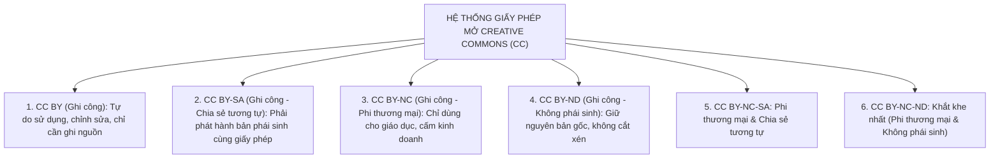
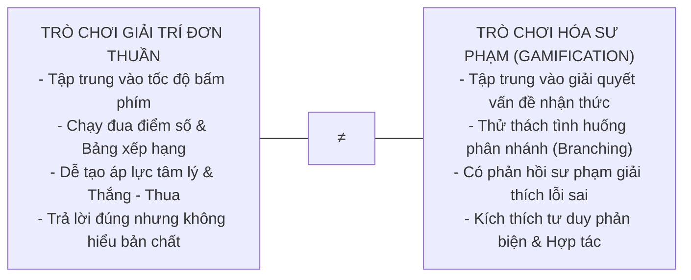
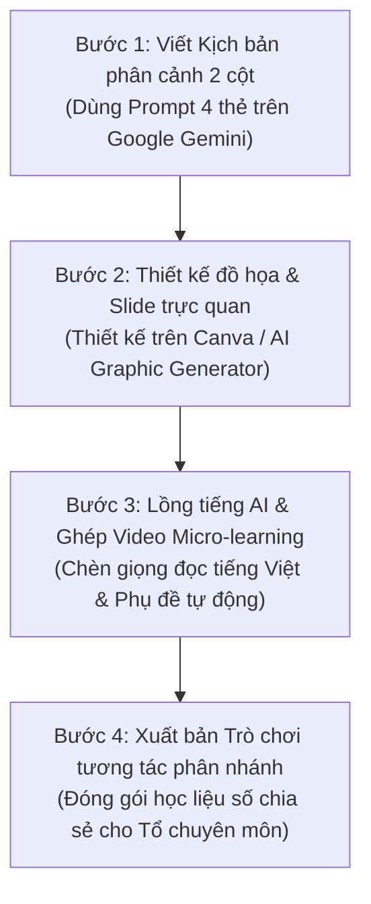

# BỘ GIÁO DỤC VÀ ĐÀO TẠO — HỌC VIỆN QUẢN LÝ GIÁO DỤC
### SỞ GIÁO DỤC VÀ ĐÀO TẠO TỈNH NGHỆ AN
***

# TÀI LIỆU BỒI DƯỠNG NĂNG LỰC SỐ VÀ SƯ PHẠM SỐ THÍCH ỨNG CẤP TRUNG HỌC CƠ SỞ
### *(Tài liệu lưu hành nội bộ phục vụ bồi dưỡng Cán bộ quản lý và Giáo viên THCS tỉnh Nghệ An – Năm học 2026–2027)*

---

## CHUYÊN ĐỀ 4: SÁNG TẠO HỌC LIỆU ĐA PHƯƠNG TIỆN & TRÒ CHƠI HÓA (GAMIFICATION) TRONG DẠY HỌC THCS

- **Mã chuyên đề:** CĐ-04/THCS-NA
- **Thời lượng:** 04 tiết (180 phút) — Buổi chiều Ngày 2
- **Đối tượng:** Cán bộ quản lý (Hiệu trưởng, Phó Hiệu trưởng), Tổ trưởng chuyên môn và Giáo viên cốt cán cấp THCS
- **Đơn vị phát triển nội dung:** Học viện Quản lý Giáo dục (NAEM) phối hợp Sở GD&ĐT Nghệ An

---

### MỤC LỤC CHUYÊN ĐỀ
1. **MỤC TIÊU BỒI DƯỠNG VÀ CHUẨN ĐẦU RA CHUYÊN ĐỀ**
2. **PHẦN I: BẢN QUYỀN SỐ, GIẤY PHÉP MỞ CREATIVE COMMONS VÀ ĐẠO ĐỨC HỌC LIỆU**
   - 1.1. Các nguyên tắc cơ bản của Luật Sở hữu trí tuệ trong môi trường giáo dục số
   - 1.2. Hệ thống 06 loại giấy phép mở Creative Commons (CC) thông dụng
   - 1.3. Quy tắc trích dẫn nguồn chuẩn quốc tế TASL (Title – Author – Source – License)
   - 1.4. Nguyên tắc minh bạch khi sử dụng hình ảnh/âm thanh do AI tạo sinh (ATM6 & ATM7)
3. **PHẦN II: THIẾT KẾ HỆ SINH THÁI HỌC LIỆU TRỰC QUAN MICRO-LEARNING**
   - 2.1. Thuyết Tải nhận thức (Cognitive Load Theory) và đặc điểm tiếp nhận thông tin của học sinh THCS
   - 2.2. Kỹ thuật thiết kế Infographic và Slide bài giảng trực quan hóa kiến thức phức tạp
   - 2.3. Nguyên tắc tối giản chữ, tối đa hóa sơ đồ tư duy và hình ảnh biểu đạt bản chất
4. **PHẦN III: QUY TRÌNH SẢN XUẤT VIDEO MICRO-LEARNING 3 PHÚT CHUẨN SƯ PHẠM**
   - 3.1. Cấu trúc kịch bản phân cảnh 2 cột (Hình ảnh thị giác ↔ Lời thoại thuyết minh)
   - 3.2. Ứng dụng giọng đọc trí tuệ nhân tạo tiếng Việt chuẩn (AI Neural Voice)
   - 3.3. Tích hợp phụ đề tự động (Auto Subtitles) hỗ trợ học sinh khuyết tật và học sinh vùng cao
5. **PHẦN IV: ỨNG DỤNG TRÒ CHƠI HÓA (GAMIFICATION) KÍCH THÍCH TƯ DUY PHẢN BIỆN**
   - 4.1. Phân biệt Trò chơi hóa sư phạm (Gamification) với trò chơi giải trí đơn thuần
   - 4.2. Cơ chế cốt lõi: Phân nhánh tình huống (Branching Scenario) và phản hồi sư phạm tức thì
   - 4.3. Giảm áp lực điểm số, tập trung vào trải nghiệm vượt qua thử thách học tập
6. **PHẦN V: QUY TRÌNH 4 BƯỚC SẢN XUẤT HỌC LIỆU BẰNG CÔNG CỤ SỐ VÀ PROMPT 4 THẺ**
   - 6.1. Mẫu Prompt 07: Biên soạn kịch bản phân cảnh Video Micro-learning 3 phút
   - 6.2. Mẫu Prompt 08: Thiết kế trò chơi học tập tương tác phân nhánh tình huống
7. **PHẦN VI: BẢNG TIÊU CHÍ ĐÁNH GIÁ NGHIỆM THU HỌC LIỆU SỐ (RUBRIC NHIỆM VỤ 04)**
8. **PHẦN VII: BẢNG KIỂM BÀN GIAO SẢN PHẨM VÀ KẾ HOẠCH HÀNH ĐỘNG CÁ NHÂN**

---

### MỤC TIÊU BỒI DƯỠNG VÀ CHUẨN ĐẦU RA CHUYÊN ĐỀ

#### 1. Về kiến thức
- Nắm vững các quy định pháp lý về bản quyền số, cách phân loại và sử dụng hợp pháp các tài nguyên số có giấy phép mở Creative Commons (CC).
- Hiểu rõ nguyên lý thiết kế học liệu Micro-learning (dưới 3–5 phút) dựa trên Thuyết Tải nhận thức nhằm tối ưu hóa sự tập trung của học sinh THCS.
- Nắm vững cấu trúc kịch bản phân cảnh video 2 cột và các yếu tố cơ bản của Trò chơi hóa (Gamification) giáo dục.

#### 2. Về kỹ năng
- Thiết kế được 01 Infographic tóm tắt bài học hoặc bài trình chiếu trực quan hóa bản chất kiến thức bằng các công cụ số hiện đại.
- Viết kịch bản và sản xuất hoàn chỉnh 01 Video Micro-learning 3 phút có giọng thuyết minh AI tiếng Việt chuẩn và phụ đề rõ nét.
- Thiết lập được 01 trò chơi học tập tương tác dạng phân nhánh tình huống có phản hồi giải thích kiến thức sư phạm.

#### 3. Về thái độ và đạo đức nghề nghiệp
- Tuyệt đối tuân thủ văn hóa trích dẫn nguồn, không vi phạm bản quyền tác giả trong các tài liệu giảng dạy.
- Thể hiện sự tôn trọng người học qua việc thiết kế học liệu thẩm mỹ, khoa học, nhân văn và dễ tiếp cận cho mọi đối tượng học sinh.

---

### PHẦN I: BẢN QUYỀN SỐ, GIẤY PHÉP MỞ CREATIVE COMMONS VÀ ĐẠO ĐỨC HỌC LIỆU

#### 1.1. Các nguyên tắc cơ bản của Luật Sở hữu trí tuệ trong môi trường giáo dục số

Trong kỷ nguyên số, việc tải tranh ảnh, video clip, tài liệu trên mạng về sử dụng trong giảng dạy rất phổ biến nhưng tiềm ẩn nhiều nguy cơ vi phạm pháp luật nếu giáo viên không nắm vững các nguyên tắc:
1. **Không phải cái gì hiển thị trên Google đều là miễn phí:** Hình ảnh tìm thấy trên Google Images phần lớn đều có bản quyền của tác giả hoặc tổ chức thương mại.
2. **Quyền "Sử dụng hợp lý" (Fair Use) trong giáo dục:** Giáo viên được phép trích dẫn một phần tác phẩm phục vụ mục đích giảng dạy phi thương mại, nhưng **bắt buộc phải ghi rõ tên tác giả và nguồn gốc tác phẩm**.
3. **Nghiêm cấm hành vi thương mại hóa hoặc nhận vơ tác quyền:** Không được tải tài liệu của đồng nghiệp rồi xóa tên tác giả để thay bằng tên mình; không được bán lại học liệu mở.

#### 1.2. Hệ thống 06 loại giấy phép mở Creative Commons (CC) thông dụng



#### 1.3. Quy tắc trích dẫn nguồn chuẩn quốc tế TASL

Mọi hình ảnh, video clip, đoạn văn trích dẫn đưa vào bài giảng phải có chú thích theo công thức **TASL**:
- **T - Title (Tên tác phẩm):** Tên bức tranh, tên biểu đồ hoặc tên video.
- **A - Author (Tên tác giả / Đơn vị sở hữu):** Tên người chụp, họa sĩ hoặc cơ quan phát hành.
- **S - Source (Nguồn dẫn):** Đường link URL dẫn đến bài đăng gốc.
- **L - License (Loại giấy phép):** Ghi rõ loại giấy phép (ví dụ: *Ảnh: NASA / Wikimedia Commons / Giấy phép CC BY 4.0*).

#### 1.4. Nguyên tắc minh bạch khi sử dụng hình ảnh/âm thanh do AI tạo sinh

Theo quy định tại Điều 14 Luật Trí tuệ nhân tạo và Công văn 6206 (ATM6 & ATM7):
- Các sản phẩm học liệu do AI tạo ra (tranh vẽ bằng Midjourney/Canva Magic, giọng đọc AI, văn bản do Gemini tạo) không có quyền tác giả tự nhiên của con người.
- Giáo viên bắt buộc phải chú thích minh bạch: *"Hình ảnh minh họa được tạo bởi Google Gemini"* hoặc *"Thuyết minh video sử dụng giọng đọc AI tiếng Việt (Neural Voice)"*. Hành vi này nêu gương liêm chính học thuật cho học sinh.

---

### PHẦN II: THIẾT KẾ HỆ SINH THÁI HỌC LIỆU TRỰC QUAN MICRO-LEARNING

#### 2.1. Thuyết Tải nhận thức và đặc điểm tiếp nhận của học sinh THCS

Học sinh lứa tuổi 11–14 có bộ nhớ làm việc (Working Memory) hữu hạn và rất dễ bị phân tán bởi các chi tiết thừa thãi. Thuyết Tải nhận thức (John Sweller) chỉ ra 3 loại tải nhận thức:
1. **Tải nội tại (Intrinsic Load):** Độ khó bản chất của khái niệm bài học (cần duy trì phù hợp lứa tuổi).
2. **Tải ngoại lai (Extraneous Load):** Gánh nặng do cách trình bày học liệu tồi tạo ra (slide quá nhiều chữ, màu sắc lòe loẹt, phông chữ rối mắt, hoạt hình nhảy nhót vô nghĩa). **Cần triệt tiêu tối đa tải ngoại lai!**
3. **Tải hữu ích (Germane Load):** Nỗ lực trí tuệ giúp học sinh hình thành lược đồ nhận thức (Schema) sâu sắc. **Cần tối đa hóa tải hữu ích!**

#### 2.2. Kỹ thuật thiết kế Infographic và Slide bài giảng trực quan

```
┌────────────────────────────────────────────────────────────────────────┐
│                   BỘ QUY TẮC THIẾT KẾ HỌC LIỆU TRỰC QUAN               │
├────────────────────────────────────────────────────────────────────────┤
│ 1. NGUYÊN TẮC 6 x 6:                                                   │
│ Mỗi slide không quá 6 dòng chữ, mỗi dòng không quá 6 từ. Tuyệt đối     │
│ không biến slide thành văn bản Word để thầy đọc trò chép.               │
├────────────────────────────────────────────────────────────────────────┤
│ 2. ĐỘ TƯƠNG PHẢN & PHÔNG CHỮ CHUẨN:                                    │
│ Chữ tối trên nền sáng (hoặc chữ sáng trên nền tối). Sử dụng phông chữ  │
│ không chân (Sans-serif) dễ đọc: Roboto, Open Sans, Inter. Cỡ chữ tiêu  │
│ đề tối thiểu 36pt, cỡ chữ nội dung tối thiểu 24pt.                    │
├────────────────────────────────────────────────────────────────────────┤
│ 3. SƠ ĐỒ HÓA KHÁI NIỆM (VISUAL CHUNKING):                             │
│ Thay thế các đoạn văn dài bằng Sơ đồ luồng (Flowchart), Bảng ma trận   │
│ so sánh hoặc Sơ đồ xương cá (Fishbone Diagram) giúp não bộ tiếp nhận   │
│ cấu trúc tri thức nhanh gấp 6 lần đọc chữ.                             │
└────────────────────────────────────────────────────────────────────────┘
```

---

### PHẦN III: QUY TRÌNH SẢN XUẤT VIDEO MICRO-LEARNING 3 PHÚT CHUẨN SƯ PHẠM

#### 3.1. Cấu trúc kịch bản phân cảnh 2 cột (Hình ảnh thị giác ↔ Lời thoại thuyết minh)

Một video bài giảng ngắn (3 phút) đạt chuẩn phải được viết kịch bản chi tiết trước khi quay hoặc dựng:

*Bảng phân cảnh mẫu (Trích đoạn 30 giây đầu của bài học):*

| Thời lượng (Timecode) | Cột 1: Hình ảnh thị giác (Visual Storyboard) | Cột 2: Lời thoại thuyết minh (Audio Voiceover) | Chú thích kỹ thuật / Học liệu |
| :---: | :--- | :--- | :--- |
| **00:00 – 00:15** | Màn hình đen chuyển sang hình ảnh vệ tinh chụp bão lũ miền Trung; phóng to tỉnh Nghệ An. Tiêu đề hiện ra: *"Bí ẩn áp thấp nhiệt đới"*. | *"Đã bao giờ các em tự hỏi: Tại sao bão nhiệt đới thường đổ bộ vào bờ biển miền Trung và gây mưa lớn kéo dài?"* | Nhạc nền mở đầu kịch tính (Volume 15%); chữ xuất hiện từng dòng. |
| **00:15 – 00:35** | Mô hình đồ họa 3D mô tả khối không khí nóng bốc lên cao và xoáy tròn ngược chiều kim đồng hồ. | *"Hôm nay, chúng ta sẽ cùng khám phá cỗ máy nhiệt khổng lồ của tự nhiên: Cơ chế hình thành áp thấp nhiệt đới."* | Âm thanh tiếng gió thổi nhẹ; mũi tên động chỉ hướng gió. |
| **00:35 – 01:20** | Thí nghiệm mô phỏng sự chênh lệch áp suất giữa hai bình khí nóng và lạnh. | *"Khi không khí bị hun nóng, mật độ phân tử giảm đi khiến áp suất giảm xuống, kéo các luồng gió xung quanh tràn vào..."* | Chèn câu hỏi tương tác ngắn: *"Áp suất vùng tâm bão cao hay thấp?"* |

#### 3.2. Ứng dụng giọng đọc trí tuệ nhân tạo tiếng Việt chuẩn (AI Neural Voice)

- Sử dụng các công nghệ giọng đọc trí tuệ nhân tạo thế hệ mới (Edge-TTS, Google Text-to-Speech) với các giọng đọc tiếng Việt truyền cảm, phát âm tự nhiên (như `vi-VN-NamMinhNeural` cho giọng nam trầm ấm hoặc `vi-VN-HoaiMyNeural` cho giọng nữ thanh thoát).
- Tốc độ nói chuẩn: Từ 120 đến 140 từ/phút, đảm bảo học sinh nghe rõ từng thuật ngữ khoa học mà không bị cảm giác máy móc khô cứng.

#### 3.3. Tích hợp phụ đề tự động (Auto Subtitles)

- Mọi video Micro-learning bắt buộc phải bật phụ đề tiếng Việt chuẩn ngữ pháp (Open Captions hoặc Closed Captions).
- Phụ đề giúp học sinh ghi nhớ từ khóa chính xác, đồng thời hỗ trợ tối đa học sinh khiếm thính hoặc học sinh học tập trong điều kiện môi trường ồn ào, thiếu tai nghe.

---

### PHẦN IV: ỨNG DỤNG TRÒ CHƠI HÓA (GAMIFICATION) KÍCH THÍCH TƯ DUY PHẢN BIỆN

#### 4.1. Phân biệt Trò chơi hóa sư phạm với chơi game giải trí đơn thuần



#### 4.2. Cơ chế cốt lõi: Phân nhánh tình huống (Branching Scenario)

Học sinh không chỉ chọn đáp án A, B, C, D một cách may rủi; học sinh được đóng vai nhân vật trong một câu chuyện thực tế:
- **Nếu chọn phương án A (Sai lầm phổ biến):** Trò chơi dẫn đến một hậu quả giả định, sau đó hiển thị màn hình giải thích: *"Tại sao lựa chọn này lại dẫn đến sai lầm? Mời em đọc lại trang 45 SGK để thử lại"*.
- **Nếu chọn phương án B (Đúng đắn):** Trò chơi mở khóa tiếp chặng hành trình tiếp theo, kèm theo huy hiệu vinh danh năng lực.

---

### PHẦN V: QUY TRÌNH 4 BƯỚC SẢN XUẤT HỌC LIỆU BẰNG CÔNG CỤ SỐ VÀ PROMPT 4 THẺ



#### 5.1. Mẫu Prompt 07: Biên soạn kịch bản phân cảnh Video Micro-learning 3 phút

```markdown
[Ngữ cảnh]
Tôi là giáo viên THCS tại Nghệ An, giảng dạy môn [TÊN MÔN HỌC] lớp [6/7/8/9]. Tôi cần sản xuất 01 Video bài giảng ngắn (Micro-learning) có thời lượng chuẩn xác từ 2.5 đến 3 phút (tương đương khoảng 350-400 từ thuyết minh) để phục vụ hoạt động Khởi động hoặc Khám phá kiến thức theo mô hình Lớp học đảo ngược.

[Dữ liệu/điều kiện]
- Tên chủ đề bài học: [TÊN BÀI HỌC VÀ KHÁI NIỆM TRỌNG TÂM].
- Đối tượng người xem: Học sinh THCS (11-14 tuổi); ngôn ngữ sinh động, hấp dẫn, gần gũi nhưng chuẩn mực khoa học.
- Quy chuẩn kỹ thuật: Kịch bản phân cảnh 2 cột (Cột 1: Mô tả hình ảnh thị giác, chuyển động đồ họa; Cột 2: Lời thuyết minh chính xác từng giây).
- Đạo đức số (ATM6 & ATM7): Chỉ sử dụng các tài nguyên hình ảnh công cộng (Public Domain / Creative Commons) hoặc mô tả hình ảnh tự vẽ; không vi phạm bản quyền.

[Hướng dẫn]
1. Hãy chia kịch bản thành 5 phân cảnh logic:
   - Cảnh 1 (0:00 - 0:25): Nêu vấn đề / Câu hỏi kích thích tò mò (Hook).
   - Cảnh 2 (0:25 - 1:00): Trực quan hóa hiện tượng khoa học hoặc bối cảnh lịch sử.
   - Cảnh 3 (1:00 - 1:50): Giải thích bản chất khái niệm cốt lõi bằng sơ đồ trực quan.
   - Cảnh 4 (1:50 - 2:30): Ví dụ minh họa thực tiễn tại Việt Nam / Nghệ An.
   - Cảnh 5 (2:30 - 3:00): Câu hỏi thử thách suy ngẫm cho học sinh trước giờ học.
2. Với mỗi phân cảnh, mô tả chi tiết: Góc máy, hình ảnh xuất hiện, hiệu ứng âm thanh (SFX), nhạc nền và lời thuyết minh tương ứng.
3. Đếm số từ của lời thuyết minh để đảm bảo tốc độ nói vừa phải (dưới 130 từ/phút).

[Kết quả mong muốn]
- Bảng phân cảnh định dạng Markdown chuyên nghiệp gồm 4 cột: Phân cảnh & Thời gian / Mô tả hình ảnh thị giác / Lời thuyết minh AI / Ghi chú âm thanh & Bản quyền.
- Lời văn tự nhiên, truyền cảm, sẵn sàng nạp vào phần mềm đọc tự động tiếng Việt (AI Voiceover).
```

#### 5.2. Mẫu Prompt 08: Thiết kế trò chơi học tập tương tác phân nhánh tình huống

```markdown
[Ngữ cảnh]
Tôi là giáo viên THCS tại Nghệ An. Tôi muốn thiết kế 01 trò chơi học tập tương tác số áp dụng kỹ thuật Phân nhánh tình huống (Branching Scenario) nhằm kích thích tư duy phản biện và rèn luyện kỹ năng giải quyết vấn đề cho học sinh lớp [6/7/8/9] trong môn [TÊN MÔN HỌC].

[Dữ liệu/điều kiện]
- Nội dung trọng tâm bài học: [TÊN CHỦ ĐỀ / BÀI HỌC CỤ THỂ].
- Tích hợp kỹ năng: Năng lực số học sinh (TC1 hoặc TC2) và 01 tình huống liên quan đến An toàn mạng (ATM1 đến ATM8).
- Cơ chế Gamification: Học sinh vào vai một "Nhà thám hiểm khoa học" hoặc "Hiệp sĩ an toàn số"; mỗi quyết định dẫn đến một kết quả khác nhau; có phản hồi giải thích khoa học khi chọn sai.

[Hướng dẫn]
1. Xây dựng bối cảnh câu chuyện cốt truyện (Storyline) ngắn gọn, lôi cuốn (dưới 100 từ).
2. Thiết kế 03 nút thắt tình huống (Decision Points):
   - Tại mỗi nút thắt, đưa ra 03 lựa chọn: Lựa chọn đúng đắn (Tiến lên) / Lựa chọn sai lầm về mặt khoa học / Lựa chọn vi phạm an toàn số hoặc đạo đức AI.
   - Với mỗi lựa chọn sai, viết đoạn phản hồi giải thích cặn kẽ vì sao sai và hướng dẫn học sinh cách tư duy lại.
3. Thiết lập hệ thống điểm số và huy hiệu danh dự: Huy hiệu "Nhà khoa học thông thái" hoặc "Chuyên gia an toàn số".
4. Đề xuất công cụ triển khai miễn phí, dễ dùng (Canva Website tương tác, Google Slides liên kết Hyperlink hoặc Quizizz/Wayground).

[Kết quả mong muốn]
- Sơ đồ cây phân nhánh tình huống dạng Mermaid hoặc bảng luồng logic.
- Nội dung câu hỏi và phản hồi chi tiết, sẵn sàng copy dán vào phần mềm tạo trò chơi.
```

---

### PHẦN VI: BẢNG TIÊU CHÍ ĐÁNH GIÁ NGHIỆM THU HỌC LIỆU SỐ (RUBRIC NHIỆM VỤ 04)

| Tiêu chí đánh giá | Mức 1: Không đạt<br>(Dưới 50% yêu cầu) | Mức 2: Cần hoàn thiện<br>(50% - 74% yêu cầu) | Mức 3: Đạt chuẩn<br>(75% - 89% yêu cầu) | Mức 4: Xuất sắc<br>(90% - 100% yêu cầu) |
| :--- | :--- | :--- | :--- | :--- |
| **Tiêu chí 1:<br>Bản quyền số & Đạo đức (ATM6)** *(Trọng số: 30%)* | Cắt ghép tranh ảnh, video của người khác không ghi nguồn; sử dụng hình ảnh có watermark bản quyền thương mại. | Có ghi nguồn nhưng sơ sài, thiếu tên tác giả hoặc loại giấy phép CC; chưa minh bạch nội dung AI. | 100% tài nguyên tuân thủ giấy phép CC và quy tắc TASL; chú thích minh bạch khi dùng AI tạo ảnh/giọng đọc. | Học liệu mẫu mực về liêm chính học thuật; hướng dẫn học sinh kỹ năng tra cứu tài nguyên mở chuyên sâu. |
| **Tiêu chí 2:<br>Chất lượng Video Micro-learning** *(Trọng số: 25%)* | Video quá dài (trên 5 phút); slide nhiều chữ; giọng đọc máy giật cục, khó nghe; không có phụ đề. | Kịch bản tương đối ổn nhưng hình ảnh chưa gắn chặt với lời thuyết minh; âm lượng nhạc nền lấn át giọng nói. | Video chuẩn 2.5–3 phút; hình ảnh trực quan sắc nét; giọng AI truyền cảm; phụ đề tiếng Việt chính xác 100%. | Video đạt chuẩn truyền hình giáo dục; phân cảnh cuốn hút; kích thích tư duy người học mạnh mẽ; thẩm mỹ cao. |
| **Tiêu chí 3:<br>Gamification & Phản hồi sư phạm** *(Trọng số: 25%)* | Trò chơi đơn thuần là trắc nghiệm tốc độ gây căng thẳng; chọn sai không có giải thích lý do vì sao sai. | Có yếu tố câu chuyện nhưng phân nhánh còn sơ sài; lời giải thích khi chọn sai còn mang tính áp đặt. | Xây dựng được cốt truyện hấp dẫn; cơ chế phân nhánh tình huống thông minh; phản hồi sư phạm ân cần, sâu sắc. | Trò chơi kích thích tối đa tư duy phản biện; học sinh tự nguyện chơi lại để hiểu sâu bản chất khoa học. |
| **Tiêu chí 4:<br>Tính khả thi & Tương thích thiết bị** *(Trọng số: 20%)* | Học liệu nặng, tải chậm; định dạng độc quyền khó mở trên điện thoại thông minh của học sinh. | Mở được trên máy tính nhưng bị vỡ khung hình hoặc lỗi font khi xem trên điện thoại hoặc tivi lớp học. | Học liệu định dạng mở (.mp4, link web tương thích đa nền tảng); dung lượng tối ưu, tải nhanh trên mạng 3G/4G. | Tối ưu hóa đa phương tiện xuất sắc; có phiên bản học liệu in giấy (Offline Card) tương thích cho vùng sâu vùng xa. |

---

### PHẦN VII: BẢNG KIỂM BÀN GIAO SẢN PHẨM VÀ KẾ HOẠCH HÀNH ĐỘNG CÁ NHÂN

#### 1. Bảng kiểm (Checklist) hồ sơ đầu ra Buổi 4
- [ ] **Sản phẩm 1:** 01 Kịch bản phân cảnh 2 cột hoàn chỉnh cho Video Micro-learning 3 phút.
- [ ] **Sản phẩm 2:** Tệp video .mp4 (hoặc link xem trực tuyến) Video bài giảng ngắn có giọng thuyết minh và phụ đề.
- [ ] **Sản phẩm 3:** 01 Bản Infographic tóm tắt bài học chuẩn bản quyền (ghi rõ giấy phép CC).
- [ ] **Sản phẩm 4:** Đường link 01 Trò chơi học tập tương tác có cơ chế phân nhánh tình huống và giải thích phản hồi.
- [ ] **Sản phẩm 5:** Báo cáo thẩm định bản quyền số có xác nhận của Cặp đôi số.

---
**NGÀY HOÀN THÀNH BIÊN SOẠN:** Năm học 2026–2027  
**CƠ QUAN CHỦ TRÌ:** Học viện Quản lý Giáo dục (NAEM) & Sở Giáo dục và Đào tạo tỉnh Nghệ An  
