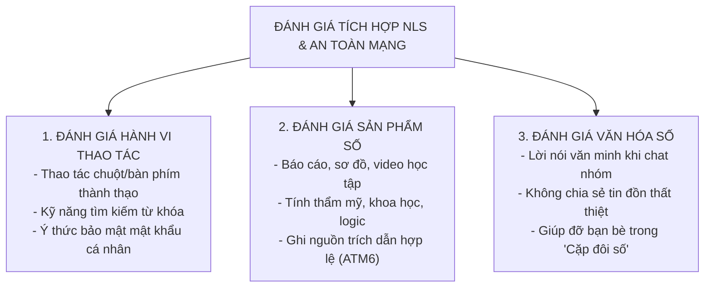
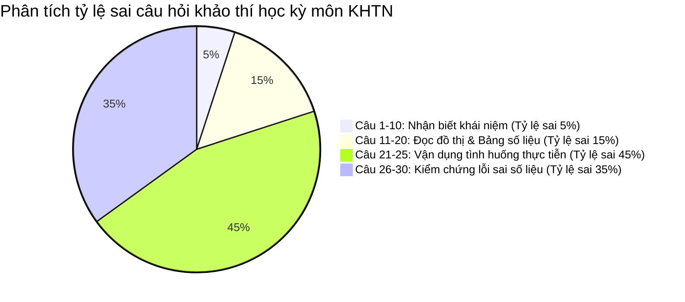

# BỘ GIÁO DỤC VÀ ĐÀO TẠO — HỌC VIỆN QUẢN LÝ GIÁO DỤC
### SỞ GIÁO DỤC VÀ ĐÀO TẠO TỈNH NGHỆ AN
***

# TÀI LIỆU BỒI DƯỠNG NĂNG LỰC SỐ VÀ SƯ PHẠM SỐ THÍCH ỨNG CẤP TRUNG HỌC CƠ SỞ
### *(Tài liệu lưu hành nội bộ phục vụ bồi dưỡng Cán bộ quản lý và Giáo viên THCS tỉnh Nghệ An – Năm học 2026–2027)*

---

## CHUYÊN ĐỀ 5: ĐỔI MỚI KHẢO THÍ SỐ PHÂN HÓA & THIẾT LẬP TRỢ LÝ ẢO CHUYÊN BIỆT

- **Mã chuyên đề:** CĐ-05/THCS-NA
- **Thời lượng:** 04 tiết (180 phút) — Buổi sáng Ngày 3
- **Đối tượng:** Cán bộ quản lý (Hiệu trưởng, Phó Hiệu trưởng), Tổ trưởng chuyên môn và Giáo viên cốt cán cấp THCS
- **Đơn vị phát triển nội dung:** Học viện Quản lý Giáo dục (NAEM) phối hợp Sở GD&ĐT Nghệ An

---

### MỤC LỤC CHUYÊN ĐỀ
1. **MỤC TIÊU BỒI DƯỠNG VÀ CHUẨN ĐẦU RA CHUYÊN ĐỀ**
2. **PHẦN I: ĐỔI MỚI ĐÁNH GIÁ THƯỜNG XUYÊN NĂNG LỰC SỐ VÀ AN TOÀN MẠNG**
   - 1.1. Nguyên tắc cốt lõi: Đánh giá vì sự tiến bộ của người học (Assessment for Learning)
   - 1.2. Đánh giá NLS và ATM qua hành vi và sản phẩm thực tế (Không chấm điểm số riêng)
   - 1.3. Phương pháp thiết kế Bảng kiểm (Checklist) và Tiêu chí định tính (Rubric)
3. **PHẦN II: TỰ ĐỘNG HÓA XÂY DỰNG NGÂN HÀNG CÂU HỎI THEO MA TRẬN ĐẶC TẢ**
   - 2.1. Cấu trúc ma trận phân hóa 3 cấp độ: Nhận biết – Thông hiểu – Vận dụng
   - 2.2. Chuẩn hóa xuất bản đề thi: Ứng dụng mã nguồn khoa học (LaTeX) và xuất file PDF chuyên nghiệp
   - 2.3. Kỹ thuật loại bỏ câu hỏi mơ hồ, câu hỏi học vẹt và chống gian lận kiểm tra số
4. **PHẦN III: KHAI THÁC PHÂN TÍCH DỮ LIỆU HỌC TẬP (LEARNING ANALYTICS)**
   - 3.1. Chuyển dịch từ "Đánh giá cảm tính" sang "Ra quyết định sư phạm dựa trên dữ liệu"
   - 3.2. Kỹ thuật đọc biểu đồ phân bố điểm số và ma trận độ khó câu hỏi trên Google Sheets
   - 3.3. Nhận diện sớm lỗ hổng kiến thức và nhóm học sinh có nguy cơ bị bỏ lại phía sau
5. **PHẦN IV: THIẾT LẬP VÀ HUẤN LUYỆN TRỢ LÝ ẢO CHUYÊN BIỆT (GEMINI GEMS)**
   - 4.1. Khái niệm Trợ lý ảo tùy biến (Custom AI Agents / Gemini Gems)
   - 4.2. Kỹ thuật cấu hình Chỉ dẫn hệ thống (System Instructions) chuẩn mực sư phạm
   - 4.3. Mô hình 01: Trợ lý Soạn giáo án & Đổi mới khảo thí (Dành cho Giáo viên)
   - 4.4. Mô hình 02: Trợ lý Quản trị văn bản & Giám sát chuyên môn (Dành cho CBQL)
6. **PHẦN V: HỆ THỐNG PROMPT 4 THẺ MẪU VỀ KHẢO THÍ SỐ VÀ HUẤN LUYỆN AI**
   - 5.1. Mẫu Prompt 09: Xây dựng ngân hàng câu hỏi phân hóa ma trận kèm mã nguồn xuất PDF
   - 5.2. Mẫu Prompt 10: Cấu hình System Instructions Trợ lý ảo chuyên môn
7. **PHẦN VI: BẢNG TIÊU CHÍ ĐÁNH GIÁ NGHIỆM THU (RUBRIC NHIỆM VỤ 05)**
8. **PHẦN VII: BẢNG KIỂM BÀN GIAO SẢN PHẨM VÀ KẾ HOẠCH HÀNH ĐỘNG CÁ NHÂN**

---

### MỤC TIÊU BỒI DƯỠNG VÀ CHUẨN ĐẦU RA CHUYÊN ĐỀ

#### 1. Về kiến thức
- Nắm vững nguyên tắc đánh giá năng lực số và an toàn mạng trong CTGDPT 2018: Đánh giá tích hợp thông qua quá trình học tập và sản phẩm thực tế, không tổ chức kiểm tra một môn học riêng biệt.
- Hiểu rõ cơ chế vận hành của phân tích dữ liệu học tập (Learning Analytics) trong việc phát hiện lỗ hổng nhận thức của học sinh.
- Nắm vững kiến trúc và nguyên lý huấn luyện Trợ lý ảo chuyên biệt (Gemini Gems) thông qua Chỉ dẫn hệ thống (System Instructions) khép kín.

#### 2. Về kỹ năng
- Thiết kế được 01 Bảng kiểm (Checklist) hoặc Rubric đánh giá năng lực số của học sinh trong 01 tiết dạy học cụ thể.
- Sử dụng AI để tự động hóa sinh ngân hàng câu hỏi phân hóa 3 mức độ bám sát ma trận đề thi của Bộ GD&ĐT, đồng thời xuất bản đề kiểm tra định dạng PDF chuẩn đẹp (không lỗi font công thức).
- Cấu hình và vận hành ổn định 01 Trợ lý ảo cá nhân hóa (Gemini Gem) phục vụ công tác chuyên môn hoặc quản trị nhà trường.

#### 3. Về thái độ và đạo đức khảo thí
- Đảm bảo tính công bằng, khách quan, bảo mật dữ liệu điểm số của học sinh theo Luật 91/2025/QH15.
- Không lạm dụng điểm số trừng phạt; coi dữ liệu khảo thí là công cụ nhân văn để hỗ trợ học sinh tiến bộ.

---

### PHẦN I: ĐỔI MỚI ĐÁNH GIÁ THƯỜNG XUYÊN NĂNG LỰC SỐ VÀ AN TOÀN MẠNG

#### 1.1. Nguyên tắc cốt lõi: Đánh giá vì sự tiến bộ của người học

Thông tư 22/2021/TT-BGDĐT quy định rõ: Đánh giá thường xuyên nhằm mục đích theo dõi, hướng dẫn, động viên học sinh hoàn thiện nhiệm vụ học tập. Đổi mới khảo thí số không phải là việc đưa các bài trắc nghiệm lên máy tính nhiều hơn, mà là:
1. **Đa dạng hóa công cụ thu thập minh chứng:** Đánh giá qua bài thuyết trình, sơ đồ tư duy, video clip, sản phẩm thực hành số hoặc thái độ tương tác trong nhóm.
2. **Phản hồi sư phạm kịp thời:** Học sinh biết rõ mình làm đúng ở đâu, sai ở khâu nào và cần làm gì để cải thiện điểm số.

#### 1.2. Đánh giá NLS và ATM qua hành vi và sản phẩm thực tế



*Nguyên tắc chỉ đạo bắt buộc:* **Tuyệt đối KHÔNG ghi điểm số môn "Năng lực số" hay "An toàn mạng" vào học bạ.** NLS và ATM được đánh giá lồng ghép vào điểm số thường xuyên của môn học chuyên môn và nhận xét rèn luyện cuối kỳ.

#### 1.3. Phương pháp thiết kế Bảng kiểm (Checklist) và Tiêu chí định tính (Rubric)

*Bảng kiểm minh chứng NLS học sinh trong giờ học thực hành (Mẫu chuẩn):*

| STT | Hành vi số quan sát được của học sinh | Đạt (✓) | Chưa đạt (✗) | Biện pháp hỗ trợ sư phạm của GV |
| :---: | :--- | :---: | :---: | :--- |
| **01** | Học sinh tự giác đăng nhập tài khoản học tập, không chia sẻ mật khẩu cho bạn bè (ATM1). | [ ] | [ ] | Hướng dẫn đặt lại mật khẩu mạnh gồm chữ hoa, số và ký tự đặc biệt. |
| **02** | Học sinh sử dụng toán tử tìm kiếm nâng cao để tra cứu tài liệu phục vụ bài học (TC1.2/TC2.2). | [ ] | [ ] | Hướng dẫn thêm từ khóa trong dấu ngoặc kép hoặc dùng Google Scholar. |
| **03** | Học sinh kiểm chứng lại số liệu tìm được với Sách giáo khoa trước khi đưa vào bài thuyết trình (ATM4). | [ ] | [ ] | Nhắc nhở quy tắc SIFT; chỉ ra nguy cơ ảo giác thông tin. |
| **04** | Sản phẩm nhóm có chú thích nguồn gốc hình ảnh và tác giả rõ ràng theo quy tắc TASL (ATM6). | [ ] | [ ] | Yêu cầu bổ sung dòng chú thích bản quyền trước khi báo cáo. |

---

### PHẦN II: TỰ ĐỘNG HÓA XÂY DỰNG NGÂN HÀNG CÂU HỎI THEO MA TRẬN ĐẶC TẢ

#### 2.1. Cấu trúc ma trận phân hóa 3 cấp độ

Đề kiểm tra định kỳ cấp THCS được chuẩn hóa theo tỷ lệ vàng:
- **Mức 1: Nhận biết (40%):** Tái hiện định nghĩa, công thức, khái niệm cơ bản.
- **Mức 2: Thông hiểu (30%):** Giải thích hiện tượng, so sánh, phân biệt và tính toán cơ bản.
- **Mức 3: Vận dụng (30%):** Vận dụng kiến thức giải quyết tình huống thực tế hoặc bài toán tổng hợp (trong đó có 10% Vận dụng cao).

#### 2.2. Chuẩn hóa xuất bản đề thi bằng mã nguồn khoa học (LaTeX) và PDF

Một vấn đề nan giải đối với giáo viên các môn Tự nhiên (Toán, KHTN, Công nghệ) là khi sao chép công thức toán học từ Word sang máy in hoặc chuyển giao giữa các máy tính khác nhau thường bị lỗi phông chữ, nhảy dòng hoặc méo mó hình vẽ.
- **Giải pháp chuyển đổi số:** Ứng dụng cú pháp **LaTeX** chuẩn hóa để biểu diễn công thức toán học và phương trình hóa học.
- AI (như Gemini) có khả năng sinh mã nguồn LaTeX trọn gói cho đề thi và xuất thẳng sang tệp PDF in ấn chuẩn nhà xuất bản mà không bị bất kỳ lỗi hiển thị nào.

*Bảng so sánh công thức Word thông thường và Mã chuẩn hóa LaTeX:*

| Công thức khoa học | Cách gõ thông thường (Dễ lỗi font) | Cú pháp chuẩn hóa LaTeX (Chuẩn xuất bản) |
| :--- | :--- | :--- |
| Định lý Pytago | a^2 + b^2 = c^2 | `$a^2 + b^2 = c^2$` |
| Phương trình bậc hai | x = (-b +- sqrt(b^2 - 4ac)) / (2a) | `$x = \frac{-b \pm \sqrt{b^2 - 4ac}}{2a}$` |
| Phản ứng hóa học | 2H2 + O2 -> 2H2O | `$2\text{H}_2 + \text{O}_2 \xrightarrow{t^\circ} 2\text{H}_2\text{O}$` |
| Tích phân / Tổng | Tong tu i=1 den n cua x_i | `$\sum_{i=1}^{n} x_i$` |

---

### PHẦN III: KHAI THÁC PHÂN TÍCH DỮ LIỆU HỌC TẬP (LEARNING ANALYTICS)

#### 3.1. Chuyển dịch từ "Đánh giá cảm tính" sang "Ra quyết định sư phạm dựa trên dữ liệu"

Trước đây, giáo viên chấm bài xong chỉ ghi điểm vào sổ điểm, khó nhận biết được toàn bộ học sinh trong khối đang hổng mảng kiến thức nào. Với công cụ khảo thí số (Google Forms / Google Sheets):
1. Hệ thống tự động vẽ biểu đồ phân bố điểm số (Hình chuông chuẩn Gauss hay lệch trái/phải).
2. Tự động thống kê **"Những câu hỏi học sinh làm sai nhiều nhất"** (Tỷ lệ sai > 50%).
3. Giúp giáo viên ngay lập tức điều chỉnh kế hoạch giảng dạy trong tiết ôn tập tiếp theo: Tập trung chữa đúng trọng tâm phần học sinh chưa hiểu, không giảng lại những phần 95% học sinh đã làm đúng.



---

### PHẦN IV: THIẾT LẬP VÀ HUẤN LUYỆN TRỢ LÝ ẢO CHUYÊN BIỆT (GEMINI GEMS)

#### 4.1. Khái niệm Trợ lý ảo tùy biến (Gemini Gems)

**Gemini Gems** (hoặc Custom GPTs) là tính năng cho phép giáo viên tạo ra một phiên bản AI riêng biệt được "dạy" trước những quy tắc chuyên môn, khung pháp lý và phong cách sư phạm cố định. Giáo viên chỉ cần thiết lập một lần duy nhất, từ đó về sau không cần phải gõ lại các câu lệnh dài dòng.

#### 4.2. Kỹ thuật cấu hình Chỉ dẫn hệ thống (System Instructions) chuẩn mực

Cấu trúc Chỉ dẫn hệ thống (System Instructions) của một Trợ lý ảo chuyên môn bao gồm 4 khối lệnh bất biến:

```
┌────────────────────────────────────────────────────────────────────────┐
│             KIẾN TRÚC SYSTEM INSTRUCTIONS TRỢ LÝ ẢO SƯ PHẠM            │
├────────────────────────────────────────────────────────────────────────┤
│ 1. ĐỊNH DANH VAI TRÒ (ROLE):                                           │
│ "Bạn là Trợ lý Sư phạm số THCS Nghệ An, chuyên gia bồi dưỡng CTGDPT    │
│ 2018 theo chuẩn Thông tư 18/2026/TT-BGDĐT và Công văn 5512."           │
├────────────────────────────────────────────────────────────────────────┤
│ 2. CƠ SỞ DỮ LIỆU CỐT LÕI (KNOWLEDGE BASE):                             │
│ Bắt buộc quy chiếu vào: CV 3456 (Chuẩn TC1/TC2), CV 6206 (ATM1-ATM8),  │
│ QĐ 2422 (Khung AI), Luật Dữ liệu cá nhân 91/2025/QH15.                 │
├────────────────────────────────────────────────────────────────────────┤
│ 3. QUY TẮC RÀNG BUỘC SƯ PHẠM (CONSTRAINTS):                            │
│ - Tuyệt đối không sinh thêm tiết học mới; tích hợp vào 4 hoạt động.    │
│ - Luôn cung cấp phương án Offline Kit dự phòng.                        │
│ - Xuất bản công thức bằng mã chuẩn LaTeX; bảng biểu định dạng Markdown.│
├────────────────────────────────────────────────────────────────────────┤
│ 4. ĐỊNH DẠNG ĐẦU RA MẶC ĐỊNH (OUTPUT FORMAT):                          │
│ Rõ ràng, ngôn ngữ chuẩn mực tài liệu quản lý giáo dục, không văn phong │
│ chào hỏi rườm rà.                                                      │
└────────────────────────────────────────────────────────────────────────┘
```

#### 4.3. Mô hình 01: Trợ lý Soạn giáo án & Đổi mới khảo thí (Dành cho Giáo viên)
- Giúp giáo viên sinh nhanh ma trận đề kiểm tra 3 cấp độ.
- Tự động tạo câu hỏi trắc nghiệm kèm lời giải thích chi tiết vì sao phương án nhiễu (distractors) lại sai.
- Đề xuất câu hỏi tình huống an toàn mạng gắn liền với bối cảnh bài học.

#### 4.4. Mô hình 02: Trợ lý Quản trị văn bản & Giám sát chuyên môn (Dành cho CBQL)
- Giúp Ban Giám hiệu tóm tắt nhanh các văn bản quy phạm pháp luật dài hàng chục trang.
- Soạn thảo dự thảo Kế hoạch hành động chuyển đổi số, biên bản nghiệm thu và thông báo gửi phụ huynh.
- Tự động đối chiếu hồ sơ giáo án của giáo viên với chuẩn chỉ báo Công văn 5512.

---

### PHẦN V: HỆ THỐNG PROMPT 4 THẺ MẪU VỀ KHẢO THÍ SỐ VÀ HUẤN LUYỆN AI

#### 5.1. Mẫu Prompt 09: Xây dựng ngân hàng câu hỏi phân hóa ma trận kèm mã nguồn xuất PDF

```markdown
[Ngữ cảnh]
Tôi là giáo viên THCS tại tỉnh Nghệ An, phụ trách môn [ĐIỀN TÊN MÔN: Toán / KHTN / Tin học] lớp [6/7/8/9]. Tôi cần xây dựng một Bộ câu hỏi kiểm tra định kỳ (Thời gian làm bài: 45 phút) theo đúng ma trận đặc tả đề thi chuẩn của Bộ Giáo dục và Đào tạo.

[Dữ liệu/điều kiện]
- Chủ đề kiểm tra: [TÊN CHỦ ĐỀ / CHƯƠNG BÀI HỌC CỤ THỂ].
- Ma trận phân hóa: Gồm 20 câu hỏi trắc nghiệm nhiều lựa chọn (4 phương án A, B, C, D):
  + Cấp độ 1 (Nhận biết): 8 câu (40%).
  + Cấp độ 2 (Thông hiểu): 6 câu (30%).
  + Cấp độ 3 (Vận dụng): 6 câu (30%, trong đó có ít nhất 01 câu vận dụng giải quyết tình huống số / an toàn dữ liệu học sinh theo Công văn 6206).
- Quy chuẩn định dạng khoa học: Mọi công thức toán học, lý hóa bắt buộc viết bằng mã nguồn LaTeX chuẩn đặt trong cặp dấu $...$ để xuất bản PDF không lỗi phông chữ.

[Hướng dẫn]
1. Lập Bảng ma trận đặc tả mục tiêu kiểm tra (Mã câu hỏi / Cấp độ tư duy / YCCĐ tương ứng).
2. Biên soạn nội dung 20 câu hỏi trắc nghiệm: Các phương án nhiễu phải có tính logic, phản ánh đúng các sai lầm phổ biến mà học sinh THCS hay mắc phải.
3. Cung cấp Bảng đáp án và Hướng dẫn giải chi tiết: Với mỗi câu, giải thích ngắn gọn vì sao đáp án đó đúng và chỉ ra lỗi sai của các phương án còn lại.
4. Xuất bản mã nguồn văn bản hoàn chỉnh sẵn sàng chuyển đổi sang tệp PDF chuyên nghiệp.

[Kết quả mong muốn]
- Định dạng xuất bản: Markdown phân cấp khoa học, hiển thị sắc nét công thức LaTeX.
- Ngôn ngữ: Chuẩn văn phong khảo thí quốc gia, khách quan, không đánh đố vô lý.
```

#### 5.2. Mẫu Prompt 10: Cấu hình System Instructions Trợ lý ảo chuyên môn (Gemini Gems)

```markdown
[Ngữ cảnh]
Tôi là Cán bộ quản lý / Tổ trưởng chuyên môn trường THCS tại Nghệ An. Tôi muốn tạo lập một Trợ lý ảo AI chuyên biệt trên nền tảng Google Gemini Gems để hỗ trợ Hội đồng sư phạm nhà trường trong việc thẩm định Kế hoạch bài dạy (KHBD) và tư vấn phương pháp sư phạm số thích ứng năm học 2026-2027.

[Dữ liệu/điều kiện]
- Tên Trợ lý: "Trợ lý Sư phạm số THCS Nghệ An - NAEM 2026".
- Văn bản pháp quy nạp sẵn trong hệ thống: Thông tư 18/2026/TT-BGDĐT, Công văn 3456/BGDĐT-GDPT, Công văn 6206/BGDĐT-GDPT, Quyết định 2422/QĐ-BGDĐT, Công văn 5512/BGDĐT-GDTrH và Luật Bảo vệ dữ liệu cá nhân 91/2025/QH15.
- Nguyên tắc vận hành: Bám sát thực tiễn cơ sở vật chất các trường học tại tỉnh Nghệ An; luôn ưu tiên tính khả thi của kịch bản dự phòng ngoại tuyến (Offline Kit).

[Hướng dẫn]
1. Hãy viết toàn văn bản Chỉ dẫn hệ thống (System Instructions) bằng tiếng Việt hoàn chỉnh cho Trợ lý này (độ dài khoảng 400-500 từ).
2. Thiết lập quy trình 3 bước khi Trợ lý thẩm định một giáo án do giáo viên gửi lên:
   - Bước 1: Rà soát cấu trúc 4C và 4 hoạt động của CV 5512.
   - Bước 2: Kiểm tra tính chuẩn xác của mã chỉ báo NLS (TC1/TC2) và an toàn mạng (ATM).
   - Bước 3: Đưa ra nhận xét góp ý ân cần, chỉ rõ điểm mạnh và đề xuất giải pháp chỉnh sửa cụ thể.
3. Thiết lập cơ chế tự kiểm duyệt an toàn: Từ chối các yêu cầu viết hộ toàn bộ giáo án mà không có dữ liệu đầu vào của giáo viên; cảnh báo nếu phát hiện thông tin định danh học sinh trong dữ liệu.

[Kết quả mong muốn]
- Bản System Instructions hoàn chỉnh, cấu trúc khối lệnh chuyên nghiệp, sẵn sàng copy dán vào ô cấu hình Instructions của Gemini Gems.
```

---

### PHẦN VI: BẢNG TIÊU CHÍ ĐÁNH GIÁ NGHIỆM THU (RUBRIC NHIỆM VỤ 05)

| Tiêu chí đánh giá | Mức 1: Không đạt<br>(Dưới 50% yêu cầu) | Mức 2: Cần hoàn thiện<br>(50% - 74% yêu cầu) | Mức 3: Đạt chuẩn<br>(75% - 89% yêu cầu) | Mức 4: Xuất sắc<br>(90% - 100% yêu cầu) |
| :--- | :--- | :--- | :--- | :--- |
| **Tiêu chí 1:<br>Đổi mới đánh giá NLS & ATM** *(Trọng số: 30%)* | Đưa ra bài thi tính điểm riêng cho NLS vi phạm quy chế; đánh giá thuần túy điểm số, thiếu phản hồi. | Có sử dụng bảng kiểm nhưng các tiêu chí còn mơ hồ, khó quan sát đo lường trong giờ dạy thực tế. | Thiết kế Bảng kiểm / Rubric định tính xuất sắc; đo lường chính xác minh chứng hành vi và sản phẩm của học sinh. | Hệ thống công cụ đánh giá thường xuyên toàn diện; phản hồi sư phạm kịp thời; kích thích học sinh tự đánh giá chéo. |
| **Tiêu chí 2:<br>Ma trận đề thi & Xuất bản PDF** *(Trọng số: 25%)* | Câu hỏi sai ma trận; công thức toán học/hóa học bị vỡ phông, lỗi font; chỉ có câu hỏi nhận biết dễ dãi. | Đủ 3 mức độ nhưng tỷ lệ chưa cân đối; xuất file PDF còn nhảy trang, lỗi canh lề. | Đề thi bám sát ma trận 4:3:3 của Bộ GD&ĐT; 100% công thức viết bằng LaTeX chuẩn; xuất file PDF đẹp mắt, chuyên nghiệp. | Ngân hàng câu hỏi phân hóa đỉnh cao; có câu hỏi tình huống số thực chiến xuất sắc; lời giải chi tiết mang tính giáo dục sâu. |
| **Tiêu chí 3:<br>Cấu hình Trợ lý ảo Gemini Gems** *(Trọng số: 25%)* | Không cấu hình được Trợ lý ảo hoặc cấu hình sai; câu trả lời của Trợ lý lan man, không theo quy chuẩn sư phạm. | Trợ lý hoạt động được nhưng câu trả lời còn chung chung; chưa bám sát các văn bản chỉ đạo của Bộ GD&ĐT. | Cấu hình System Instructions bài bản; Trợ lý thẩm định giáo án sắc sảo, dẫn chứng đúng điều khoản Thông tư 18 và CV 5512. | Trợ lý ảo trở thành người đồng hành chuyên môn xuất sắc; xử lý tình huống linh hoạt; chia sẻ hữu ích cho toàn trường. |
| **Tiêu chí 4:<br>Bảo mật dữ liệu điểm số (Luật 91)** *(Trọng số: 20%)* | Công khai danh sách điểm số kèm họ tên, ngày sinh của học sinh lên mạng xã hội; để lộ dữ liệu cá nhân. | Bảng tổng hợp điểm số chưa được phân quyền truy cập an toàn; còn nguy cơ rò rỉ thông tin. | 100% ẩn danh hóa dữ liệu khảo thí khi phân tích; thực hiện nghiêm quy chế bảo mật thông tin học sinh. | Xây dựng quy trình quản trị dữ liệu khảo thí số an toàn tuyệt đối; phân quyền rõ ràng giữa BGH, GVCN và Phụ huynh. |

---

### PHẦN VII: BẢNG KIỂM BÀN GIAO SẢN PHẨM VÀ KẾ HOẠCH HÀNH ĐỘNG CÁ NHÂN

#### 1. Bảng kiểm (Checklist) hồ sơ đầu ra Buổi 5
- [ ] **Sản phẩm 1:** 01 Bảng kiểm (Checklist) hoặc Rubric đánh giá thường xuyên NLS & ATM trong môn học.
- [ ] **Sản phẩm 2:** 01 Bộ đề kiểm tra phân hóa 3 cấp độ (kèm ma trận đặc tả và đáp án giải thích chi tiết).
- [ ] **Sản phẩm 3:** Tệp PDF đề kiểm tra xuất bản chuẩn hóa không lỗi phông chữ công thức.
- [ ] **Sản phẩm 4:** Đường link và Bản cấu hình System Instructions 01 Trợ lý ảo (Gemini Gem) hoạt động ổn định.
- [ ] **Sản phẩm 5:** Biên bản kiểm định bảo mật dữ liệu khảo thí của Tổ chuyên môn.

---
**NGÀY HOÀN THÀNH BIÊN SOẠN:** Năm học 2026–2027  
**CƠ QUAN CHỦ TRÌ:** Học viện Quản lý Giáo dục (NAEM) & Sở Giáo dục và Đào tạo tỉnh Nghệ An  
