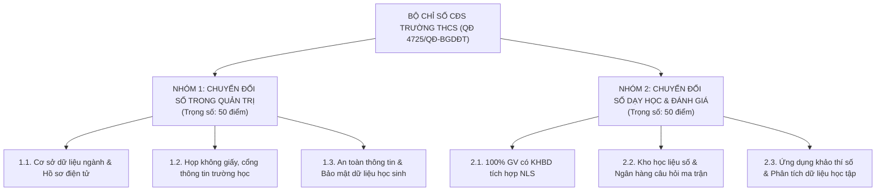
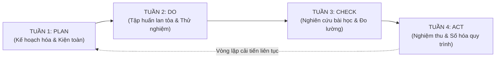

# BỘ GIÁO DỤC VÀ ĐÀO TẠO — HỌC VIỆN QUẢN LÝ GIÁO DỤC
### SỞ GIÁO DỤC VÀ ĐÀO TẠO TỈNH NGHỆ AN
***

# TÀI LIỆU BỒI DƯỠNG NĂNG LỰC SỐ VÀ SƯ PHẠM SỐ THÍCH ỨNG CẤP TRUNG HỌC CƠ SỞ
### *(Tài liệu lưu hành nội bộ phục vụ bồi dưỡng Cán bộ quản lý và Giáo viên THCS tỉnh Nghệ An – Năm học 2026–2027)*

---

## CHUYÊN ĐỀ 6: QUẢN TRỊ TRƯỜNG HỌC SỐ, HỒ SƠ NGHIỆM THU VÀ LỘ TRÌNH CHUYỂN HÓA PDCA 4 TUẦN

- **Mã chuyên đề:** CĐ-06/THCS-NA
- **Thời lượng:** 04 tiết (180 phút) — Buổi chiều Ngày 3 (Chuyên đề tổng kết)
- **Đối tượng:** Cán bộ quản lý (Hiệu trưởng, Phó Hiệu trưởng), Tổ trưởng chuyên môn, Trưởng các đoàn thể và Giáo viên cốt cán cấp THCS
- **Đơn vị phát triển nội dung:** Học viện Quản lý Giáo dục (NAEM) phối hợp Sở GD&ĐT Nghệ An

---

### MỤC LỤC CHUYÊN ĐỀ
1. **MỤC TIÊU BỒI DƯỠNG VÀ CHUẨN ĐẦU RA CHUYÊN ĐỀ**
2. **PHẦN I: ĐÁNH GIÁ MỨC ĐỘ CHUYỂN ĐỔI SỐ TRƯỜNG HỌC THEO QUYẾT ĐỊNH 4725/QĐ-BGDĐT**
   - 1.1. Cấu trúc Bộ chỉ số chuyển đổi số cơ sở giáo dục phổ thông
   - 1.2. Thang đo 3 mức độ chuyển đổi số và điều kiện thực tiễn vùng miền tỉnh Nghệ An
   - 1.3. Mô hình phân công trách nhiệm RACI trong quản trị chuyển đổi số nhà trường
3. **PHẦN II: TỔNG HỢP VÀ THẨM ĐỊNH HỒ SƠ NGHIỆM THU 05 SẢN PHẨM KHÓA BỒI DƯỠNG**
   - 2.1. Cấu trúc Hồ sơ số minh chứng 5 sản phẩm đầu ra (Nhiệm vụ 01 – Nhiệm vụ 05)
   - 2.2. Quy trình thẩm định chéo tổ chuyên môn và cơ chế ký số xác thực biên bản
   - 2.3. Tránh hình thức và bệnh thành tích trong nghiệm thu năng lực số
4. **PHẦN III: LỘ TRÌNH CHUYỂN HÓA SƯ PHẠM SỐ 4 TUẦN TẠI NHÀ TRƯỜNG (CHU TRÌNH PDCA)**
   - 3.1. Tuần 1 — PLAN (Kế hoạch hóa): Ban hành Kế hoạch CĐS & Kiện toàn tổ nòng cốt
   - 3.2. Tuần 2 — DO (Thực thi): Tập huấn lan tỏa nội bộ & Thử nghiệm tiết dạy 4C
   - 3.3. Tuần 3 — CHECK (Kiểm tra): Sinh hoạt chuyên môn theo NCBH & Khảo sát phản hồi
   - 3.4. Tuần 4 — ACT (Điều chỉnh & Lan tỏa): Nghiệm thu cấp trường & Báo cáo Phòng GD&ĐT
5. **PHẦN IV: HỆ THỐNG PROMPT 4 THẺ MẪU CHO CÁN BỘ QUẢN LÝ NHÀ TRƯỜNG**
   - 4.1. Mẫu Prompt 11: Soạn thảo Kế hoạch hành động Chuyển đổi số theo Quyết định 4725
   - 4.2. Mẫu Prompt 12: Phân tích dữ liệu học kỳ và Dự thảo Báo cáo tổng kết chuyên môn
6. **PHẦN V: BẢNG TIÊU CHÍ ĐÁNH GIÁ NGHIỆM THU QUẢN TRỊ (RUBRIC NHIỆM VỤ 06)**
7. **PHẦN VI: BẢNG KIỂM BÀN GIAO TOÀN DIỆN VÀ CAM KẾT CHUYỂN HÓA SƯ PHẠM SỐ**

---

### MỤC TIÊU BỒI DƯỠNG VÀ CHUẨN ĐẦU RA CHUYÊN ĐỀ

#### 1. Về kiến thức
- Nắm vững các tiêu chí và chỉ số thành phần trong Quyết định số 4725/QĐ-BGDĐT ngày 30/12/2022 của Bộ GD&ĐT ban hành Bộ chỉ số đánh giá mức độ chuyển đổi số của cơ sở giáo dục phổ thông.
- Hiểu rõ nguyên lý chu trình PDCA (Plan – Do – Check – Act) trong quản trị chất lượng giáo dục và chuyển đổi số sư phạm tại trường học.
- Nắm vững cơ chế phân định trách nhiệm RACI nhằm tránh tình trạng "khoán trắng cho giáo viên Tin học".

#### 2. Về kỹ năng
- Tự đánh giá được mức độ chuyển đổi số của đơn vị mình theo Quyết định 4725/QĐ-BGDĐT và xác định mục tiêu nâng chuẩn trong năm học 2026–2027.
- Xây dựng được 01 Kế hoạch hành động chuyển đổi số 4 tuần sau khóa tập huấn khả thi, phù hợp với đặc thù vùng thuận lợi (TP Vinh, Nghi Lộc) hoặc vùng khó khăn (Kỳ Sơn, Quế Phong, Quỳ Châu).
- Hoàn thiện trọn vẹn Bộ hồ sơ số gồm 05 sản phẩm chuyên môn đầu ra, phục vụ nghiệm thu và cấp chứng chỉ bồi dưỡng của Học viện Quản lý Giáo dục.

#### 3. Về thái độ và tư duy lãnh đạo số
- Xác định rõ vai trò "Người mở đường và truyền cảm hứng" của Cán bộ quản lý; không xem chuyển đổi số là việc đối phó thủ tục hành chính.
- Kiên quyết thực hiện phương châm "Học thật, làm thật, sản phẩm thật, lan tỏa thật".

---

### PHẦN I: ĐÁNH GIÁ MỨC ĐỘ CHUYỂN ĐỔI SỐ TRƯỜNG HỌC THEO QUYẾT ĐỊNH 4725/QĐ-BGDĐT

#### 1.1. Cấu trúc Bộ chỉ số chuyển đổi số trường học

Bộ chỉ số ban hành theo Quyết định 4725/QĐ-BGDĐT gồm 02 nhóm tiêu chí cốt lõi:



#### 1.2. Thang đo 3 mức độ chuyển đổi số

Bộ GD&ĐT chia mức độ chuyển đổi số của cơ sở giáo dục thành 3 mức:
- **Mức 1: Chưa đáp ứng (Dưới 50 điểm):** Nhà trường mới dừng lại ở việc gõ văn bản Word, chưa có hạ tầng chia sẻ dùng chung, việc kiểm tra đánh giá và lưu trữ giáo án hoàn toàn thủ công.
- **Mức 2: Đáp ứng cơ bản (Từ 50 đến 75 điểm):** Đã vận hành hệ thống quản lý học sinh trực tuyến, giáo viên bắt đầu sử dụng bài giảng điện tử và kiểm tra trắc nghiệm số, có quy chế bảo vệ dữ liệu nội bộ.
- **Mức 3: Đáp ứng tốt (Trên 75 điểm):** Quản trị trường học dựa trên dữ liệu (Data-driven); 100% hồ sơ chuyên môn số hóa; giáo viên thành thạo trợ lý ảo AI và học liệu đa phương tiện tương tác; học sinh có không gian thực hành số thích ứng an toàn.

#### 1.3. Mô hình phân công trách nhiệm RACI trong quản trị số nhà trường

Để chuyển đổi số thành công, Ban Giám hiệu phải phân công rõ vai trò theo ma trận RACI:
- **R (Responsible - Người thực hiện):** Trực tiếp thực hiện nhiệm vụ chuyên môn.
- **A (Accountable - Người chịu trách nhiệm cao nhất):** Người phê duyệt và chịu trách nhiệm pháp lý cuối cùng (Hiệu trưởng/Phó Hiệu trưởng).
- **C (Consulted - Người tham vấn):** Chuyên gia, cốt cán chuyên môn tư vấn giải pháp.
- **I (Informed - Người nhận thông tin):** Cán bộ, giáo viên, nhân viên, phụ huynh được thông báo kết quả.

*Ma trận RACI mẫu cho trường THCS tại Nghệ An:*

| Nhiệm vụ chuyển đổi số | Ban Giám hiệu | Tổ trưởng CM | Giáo viên bộ môn | GV Tin học / CNTT |
| :--- | :---: | :---: | :---: | :---: |
| **Xây dựng Kế hoạch CĐS trường học** | **A** | C | I | R |
| **Thẩm định KHBD tích hợp NLS (CV 5512)** | A | **R** | C | I |
| **Thiết kế học liệu số & Kịch bản thích ứng** | I | A | **R** | C |
| **Bảo đảm hạ tầng mạng & Offline Kit** | A | I | I | **R** |
| **Khảo thí số & Bảo mật điểm thi (Luật 91)** | A | C | **R** | C |

---

### PHẦN II: TỔNG HỢP VÀ THẨM ĐỊNH HỒ SƠ NGHIỆM THU 05 SẢN PHẨM KHÓA BỒI DƯỠNG

Mỗi học viên hoàn thành khóa bồi dưỡng bắt buộc phải nộp đủ 05 sản phẩm chuyên môn lên Hệ thống quản trị bồi dưỡng trực tuyến:

```
┌────────────────────────────────────────────────────────────────────────┐
│               DANH MỤC 05 SẢN PHẨM ĐẦU RA KHÓA TẬP HUẤN                │
├────────────────────────────────────────────────────────────────────────┤
│ • SẢN PHẨM 01 (Buổi 1): Ma trận tích hợp NLS cấp THCS (File Excel/PDF) │
│ • SẢN PHẨM 02 (Buổi 2): Kế hoạch An toàn mạng & Quy trình SIFT 4 bước  │
│ • SẢN PHẨM 03 (Buổi 3): Kế hoạch bài dạy (KHBD) 4C chuẩn Công văn 5512 │
│ • SẢN PHẨM 04 (Buổi 4): Bộ học liệu số đa phương tiện & Thẻ trò chơi   │
│ • SẢN PHẨM 05 (Buổi 5): Công cụ đánh giá NLS, Đề thi PDF & Prompt Gem  │
└────────────────────────────────────────────────────────────────────────┘
```

#### Quy trình nghiệm thu chéo 3 bước tại cơ sở:
1. **Bước 1 (Tự kiểm tra):** Giáo viên đối chiếu sản phẩm cá nhân với Bảng kiểm nghiệm thu (Checklist) và Rubric 4 mức độ của từng Chuyên đề.
2. **Bước 2 (Thẩm định chéo Tổ bộ môn):** Tổ trưởng chuyên môn phân công 02 giáo viên thẩm định chéo, lập Biên bản góp ý chuyên môn chi tiết.
3. **Bước 3 (Phê duyệt và Ký số):** Hiệu trưởng/Phó Hiệu trưởng kiểm tra xác suất, ký số phê duyệt và gửi danh sách công nhận hoàn thành về Phòng GD&ĐT và Sở GD&ĐT.

---

### PHẦN III: LỘ TRÌNH CHUYỂN HÓA SƯ PHẠM SỐ 4 TUẦN TẠI NHÀ TRƯỜNG (CHU TRÌNH PDCA)



#### Chi tiết kế hoạch từng tuần:

- **TUẦN 1 — PLAN (Kế hoạch hóa & Tổ chức):**
  + Ban hành Quyết định thành lập Tổ công tác Chuyển đổi số và An toàn mạng trường học.
  + Tổ chức rà soát hạ tầng thiết bị, lập danh sách các lớp thuộc nhóm có mạng cáp quang ổn định và nhóm cần trang bị **Nghệ An Offline Kit** (USB 64GB, tài liệu in sẵn).
  + Họp Hội đồng Sư phạm quán triệt mục tiêu, thông qua Ma trận tích hợp NLS vào kế hoạch giáo dục nhà trường năm học 2026–2027.

- **TUẦN 2 — DO (Tập huấn lan tỏa & Thử nghiệm):**
  + Đội ngũ Cán bộ quản lý và Giáo viên cốt cán vừa được đào tạo tổ chức buổi tập huấn chuyên đề 01 ngày cho 100% giáo viên trong nhà trường.
  + Hướng dẫn toàn thể giáo viên thực hành kỹ thuật "Prompt 4 thẻ sư phạm" và cách thức tra cứu có trích dẫn.
  + Mỗi Tổ chuyên môn triển khai ít nhất 01 tiết dạy thử nghiệm có ứng dụng Kế hoạch bài dạy 4C chuẩn Công văn 5512.

- **TUẦN 3 — CHECK (Kiểm tra & Nghiên cứu bài học):**
  + Tiến hành dự giờ, sinh hoạt chuyên môn theo phương pháp Nghiên cứu bài học định hướng sư phạm số.
  + Quan sát hành vi thao tác và mức độ hào hứng của học sinh khi làm việc nhóm và tham gia trò chơi học tập.
  + Phát phiếu khảo sát trực tuyến/trực tiếp đo lường cảm nhận của học sinh và phụ huynh về phương pháp dạy học mới.

- **TUẦN 4 — ACT (Điều chỉnh & Chuẩn hóa):**
  + Tổ chuyên môn họp tổng kết rút kinh nghiệm, chỉnh sửa những điểm chưa phù hợp trong học liệu số và bảng ma trận.
  + Ban Giám hiệu tổ chức nghiệm thu sản phẩm số hóa toàn trường; lưu trữ lên Google Drive/Cổng thông tin nội bộ của nhà trường.
  + Gửi Báo cáo sơ kết giai đoạn 1 về Phòng Giáo dục và Đào tạo.

---

### PHẦN IV: HỆ THỐNG PROMPT 4 THẺ MẪU CHO CÁN BỘ QUẢN LÝ NHÀ TRƯỜNG

#### 4.1. Mẫu Prompt 11: Soạn thảo Kế hoạch hành động Chuyển đổi số theo Quyết định 4725

```markdown
[Ngữ cảnh]
Tôi là Hiệu trưởng trường THCS [ĐIỀN TÊN TRƯỜNG: THCS Đô Lương / THCS Anh Sơn / THCS Kỳ Sơn] thuộc tỉnh Nghệ An. Trường chúng tôi hiện có [SỐ LƯỢNG] cán bộ giáo viên và [SỐ LƯỢNG] học sinh. Tôi cần xây dựng "Kế hoạch hành động Chuyển đổi số và Bồi dưỡng Năng lực số năm học 2026–2027" đáp ứng mục tiêu nâng mức đánh giá theo Quyết định 4725/QĐ-BGDĐT.

[Dữ liệu/điều kiện]
- Hiện trạng nhà trường: [MÔ TẢ NGẮN: Phòng tin học 25 máy kết nối Internet; 60% phòng học có màn hình tương tác; vùng địa bàn còn nhiều khó khăn về đường truyền ngoại vi].
- Mục tiêu năm học: Đạt Mức độ 2 (Đáp ứng cơ bản) tiến tới Mức độ 3 theo chuẩn QĐ 4725; 100% giáo viên ứng dụng thành thạo AI hỗ trợ soạn giảng; 100% học sinh được trang bị kỹ năng an toàn mạng theo CV 6206.
- Cấu trúc bắt buộc: Tuân thủ quy chuẩn thể thức văn bản hành chính Việt Nam (Nghị định 30/2020/NĐ-CP).

[Hướng dẫn]
1. Xây dựng Kế hoạch hoàn chỉnh gồm 5 phần: I. Căn cứ pháp lý; II. Mục tiêu tổng quát và cụ thể; III. Các nhiệm vụ và giải pháp trọng tâm (Quản trị số, Dạy học số, Hạ tầng và An toàn thông tin); IV. Lộ trình thực hiện 4 tuần đầu năm học theo chu trình PDCA; V. Tổ chức thực hiện (Phân công trách nhiệm theo RACI).
2. Thiết kế giải pháp kỹ thuật dự phòng thích ứng (Offline Kit) cho những ngày mưa bão mất mạng Internet cáp quang.
3. Đề xuất tiêu chí khen thưởng, động viên giáo viên sáng tạo học liệu số xuất sắc.

[Kết quả mong muốn]
- Văn bản hoàn chỉnh, trang trọng, chặt chẽ, đầy đủ các mục căn cứ pháp quy hiện hành (TT 18/2026, CV 3456, CV 6206, QĐ 2422, QĐ 4725).
```

#### 4.2. Mẫu Prompt 12: Phân tích dữ liệu học kỳ và Dự thảo Báo cáo tổng kết chuyên môn

```markdown
[Ngữ cảnh]
Tôi là Phó Hiệu trưởng phụ trách chuyên môn trường THCS tại Nghệ An. Tôi có bảng tổng hợp kết quả học tập và số liệu khảo thí số cuối Học kỳ 1 của toàn khối lớp 8 (gồm 4 lớp với 160 học sinh) về năng lực Khoa học tự nhiên và Năng lực số.

[Dữ liệu/điều kiện]
- Bảng dữ liệu đính kèm (hoặc tóm tắt): Điểm trung bình kiểm tra định kỳ: 7.2; Tỷ lệ học sinh đạt chuẩn NLS TC2.1 (tìm kiếm thông tin): 88%; Tỷ lệ đạt chuẩn TC2.2 (đánh giá nguồn tin giả): 54%; Tỷ lệ vi phạm an toàn mật khẩu (ATM1): 18%.
- Quy chuẩn bảo mật: Tuyệt đối không đưa họ tên thật của học sinh vào prompt (đã mã hóa thành HS01, HS02,...).

[Hướng dẫn]
1. Hãy phân tích chuyên sâu các chỉ số trên theo phương pháp Learning Analytics: Chỉ ra những điểm sáng vượt bậc và các nguy cơ tiềm ẩn trong năng lực học sinh.
2. Giải thích nguyên nhân vì sao tỷ lệ đánh giá nguồn tin giả (TC2.2) còn thấp và vì sao còn hiện tượng lộ mật khẩu tài khoản học tập.
3. Đề xuất 03 giải pháp hành động cụ thể cho Tổ chuyên môn trong Học kỳ 2 nhằm khắc phục triệt để các hạn chế trên mà không làm quá tải cho giáo viên.
4. Dự thảo 01 Báo cáo sơ kết chuyên môn ngắn gọn (khoảng 600 từ) để trình bày trước Hội đồng Sư phạm nhà trường.

[Kết quả mong muốn]
- Báo cáo phân tích sắc sảo, dẫn chứng trực tiếp từ số liệu, giải pháp thực tế và có tính thuyết phục quản trị cao.
```

---

### PHẦN V: BẢNG TIÊU CHÍ ĐÁNH GIÁ NGHIỆM THU QUẢN TRỊ (RUBRIC NHIỆM VỤ 06)

| Tiêu chí đánh giá | Mức 1: Không đạt<br>(Dưới 50% yêu cầu) | Mức 2: Cần hoàn thiện<br>(50% - 74% yêu cầu) | Mức 3: Đạt chuẩn<br>(75% - 89% yêu cầu) | Mức 4: Xuất sắc<br>(90% - 100% yêu cầu) |
| :--- | :--- | :--- | :--- | :--- |
| **Tiêu chí 1:<br>Đánh giá hiện trạng CĐS theo QĐ 4725** *(Trọng số: 30%)* | Không nắm được tiêu chí QĐ 4725; đánh giá hình thức, tự cho điểm tối đa không có minh chứng. | Có chấm điểm theo bộ chỉ số nhưng minh chứng sơ sài; chưa chỉ ra được khoảng cách cần cải thiện. | Đánh giá chính xác thực trạng nhà trường theo 2 nhóm chỉ số; có đầy đủ minh chứng thực tế; xác định đúng mức độ đạt chuẩn. | Phân tích hiện trạng sâu sắc; xây dựng bản đồ số hóa toàn trường; dự báo chính xác các thách thức và cơ hội phát triển. |
| **Tiêu chí 2:<br>Kế hoạch hành động 4 tuần (PDCA)** *(Trọng số: 30%)* | Kế hoạch sao chép chung chung, không gắn với trường học thực tế; thiếu mốc thời gian và chỉ tiêu cụ thể. | Có chia 4 tuần nhưng công việc dồn ứ; chưa phân định rõ vai trò trách nhiệm giữa các bộ phận. | Kế hoạch PDCA khoa học, khả thi cao; phân công RACI rõ ràng; có giải pháp dự phòng thích ứng vùng miền (Offline Kit). | Kế hoạch xuất sắc, tính khả thi 100%; có cơ chế giám sát tiến độ tự động; trở thành mô hình điểm để các trường bạn học tập. |
| **Tiêu chí 3:<br>Nghiệm thu trọn bộ 05 sản phẩm** *(Trọng số: 25%)* | Nộp thiếu sản phẩm (dưới 3 sản phẩm); sản phẩm vi phạm bản quyền hoặc làm đối phó sai quy định. | Nộp đủ 5 sản phẩm nhưng chất lượng trung bình; còn lỗi thể thức văn bản hoặc lỗi font công thức. | Nộp đầy đủ 05 sản phẩm chuyên môn chất lượng cao; bám sát chuẩn Thông tư 18, CV 3456, CV 6206 và CV 5512. | Bộ sản phẩm mẫu mực, hoàn thiện xuất sắc; có thể sử dụng làm nguồn học liệu dùng chung cho toàn ngành GD&ĐT tỉnh. |
| **Tiêu chí 4:<br>Tư duy lãnh đạo số & Đạo đức quản trị** *(Trọng số: 15%)* | Còn tư duy đối phó, ép buộc giáo viên; vi phạm quy định bảo mật hồ sơ học sinh và viên chức. | Nhận thức chuyển đổi số tốt nhưng kỹ năng truyền cảm hứng còn hạn chế; ngại đổi mới quy trình cũ. | Phong cách lãnh đạo dân chủ, đồng hành cùng giáo viên; tuân thủ nghiêm ngặt Luật Bảo vệ dữ liệu cá nhân 91/2025/QH15. | Người dẫn dắt chuyển đổi số truyền cảm hứng mạnh mẽ; xây dựng văn hóa số lành mạnh, nhân văn và đoàn kết trong trường học. |

---

### PHẦN VI: BẢNG KIỂM BÀN GIAO TOÀN DIỆN VÀ CAM KẾT CHUYỂN HÓA SƯ PHẠM SỐ

#### 1. Bảng kiểm bàn giao Hồ sơ minh chứng toàn khóa (Dành cho Cán bộ quản lý & Giáo viên cốt cán)

Học viên đánh dấu (✓) vào các mục đã hoàn thành đầy đủ trước khi xuất biên bản tổng kết:

- [ ] **Mục 01 (Cơ sở pháp lý & Ma trận):** Bản cam kết thực hiện đúng Thông tư 18/2026/TT-BGDĐT và Ma trận phân bổ chỉ báo NLS (TC1/TC2) cho toàn bộ chương trình môn học.
- [ ] **Mục 02 (An toàn mạng & Đạo đức AI):** Kế hoạch triển khai 8 nhóm nội dung Công văn 6206/BGDĐT-GDPT và Quy trình hướng dẫn học sinh kiểm chứng tin giả theo công thức SIFT.
- [ ] **Mục 03 (Kế hoạch bài dạy 4C):** Kế hoạch bài dạy (KHBD) 01 tiết hoàn chỉnh chuẩn Công văn 5512 tích hợp 4 hoạt động và kịch bản sư phạm thích ứng Offline Kit.
- [ ] **Mục 04 (Học liệu số & Trò chơi):** Bộ học liệu đa phương tiện gồm Slide bài giảng chuẩn TASL và Thẻ thiết kế trò chơi học tập tương tác số.
- [ ] **Mục 05 (Khảo thí & Trợ lý ảo):** Đề kiểm tra ma trận phân hóa 3 mức độ xuất bản PDF chuẩn LaTeX kèm link cấu hình Trợ lý ảo Gemini Gem nạp sẵn văn bản chuyên môn.
- [ ] **Mục 06 (Quản trị & Lộ trình PDCA):** Kế hoạch hành động chuyển đổi số 4 tuần của nhà trường/tổ bộ môn có phân định trách nhiệm RACI theo Quyết định 4725/QĐ-BGDĐT.

#### 2. Lời cam kết danh dự của Nhà giáo Nghệ An
*"Chúng tôi — Cán bộ quản lý và Giáo viên THCS tỉnh Nghệ An — cam kết đem toàn bộ tri thức, kỹ năng và ngọn lửa nhiệt huyết từ khóa bồi dưỡng này lan tỏa tới từng đồng nghiệp, từng lớp học và từng học sinh thân yêu. Biến công nghệ số và trí tuệ nhân tạo thành đòn bẩy nâng cánh ước mơ cho thế hệ trẻ quê Bác, giữ vững tinh thần hiếu học, sáng tạo và nhân văn của vùng đất Lam Hồng địa linh nhân kiệt!"*

---
**NGÀY HOÀN THÀNH BIÊN SOẠN:** Năm học 2026–2027  
**CƠ QUAN PHÊ DUYỆT:**  
- **HỌC VIỆN QUẢN LÝ GIÁO DỤC (NAEM)**  
- **SỞ GIÁO DỤC VÀ ĐÀO TẠO TỈNH NGHỆ AN**  
